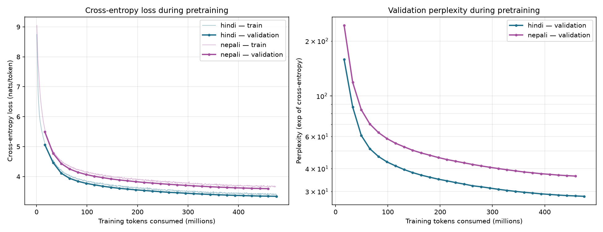
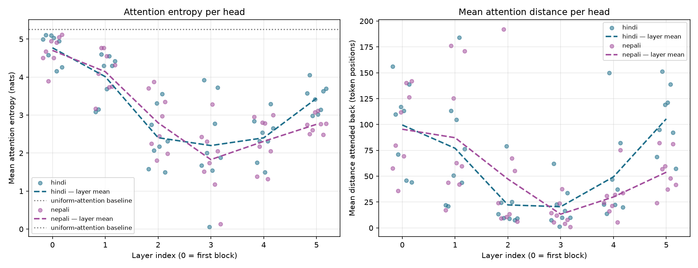
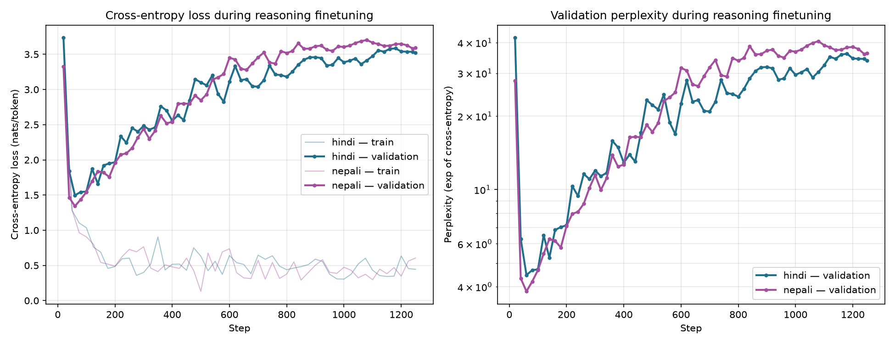

# Language Models and Agents - Individual Project

Two separate decoder-only Transformer language models, built from scratch, one
for a higher-resource Indian language and one for a lower-resource one.

- **Model H = Hindi** (higher-resource)
- **Model L = Nepali** (lower-resource, from the allowed list in the project brief)

The work covers everything: collecting the text, training a tokenizer, writing
the Transformer with basic PyTorch layers, pretraining, evaluation, and
finetuning on reasoning questions. All of it was done twice, once per language.
All three phases are finished.

The two models share no data, no tokenizer, no vocabulary and no weights. The
`hindi/` and `nepali/` folders are separate Python packages. Neither one imports
the other, and every command works on exactly one language.

Both languages use the Devanagari script. That was on purpose: because the script
is the same, it cannot be the reason for any difference between the two models,
so what is left is the size and quality of the data and the tokenizer.

---

## Where to look first

| What you want | Where it is |
|---|---|
| The full project in one document (9 pages, PDF) | [report/final/final_report.pdf](report/final/final_report.pdf) |
| Phase 3 report (required consolidated report) | [report/phase3/phase3_report.md](report/phase3/phase3_report.md) |
| Phase 2 report | [report/phase2/phase2_report.md](report/phase2/phase2_report.md) |
| Phase 1 report | [report/phase1/phase1_report.md](report/phase1/phase1_report.md) ([PDF](report/phase1/phase1_report.pdf)) |
| List of files for each phase | [phase 1](report/phase1/README.md) - [phase 2](report/phase2/README.md) - [phase 3](report/phase3/README.md) |
| Model checkpoints (too large for git) | [Google Drive](https://drive.google.com/drive/folders/15kYy6N9YaCx1wk2JMg8k8udf1szQfneT?usp=sharing) |
| Corpora (too large for git) | [OneDrive](https://iiithydstudents-my.sharepoint.com/:f:/g/personal/swaraj_kumar_students_iiit_ac_in/IgCh3u8O2sr4QIJqmrUS1CllAV1C5HL0R9SOWUUVIzTgcdw?e=bgUHaG) |

---

## Everything in one table

| | Model H - Hindi | Model L - Nepali |
|---|---:|---:|
| **Phase 1 - corpus** | | |
| Documents | 704,101 | 1,918,265 |
| Total tokens | 505,852,028 | 635,204,333 |
| Share of the 500M target | 101.2% | 127.0% |
| Manually collected share | 30.66% | 26.41% |
| **Phase 1 - tokenizer** | | |
| Type and vocabulary size | SentencePiece Unigram, 8,000 | SentencePiece BPE, 10,000 |
| Bytes per token | 8.88 | 11.44 |
| Unknown-token rate (test set) | 0.000000 | 0.001894 |
| **Phase 2 - model** | | |
| Total parameters | 23,273,472 | 24,297,472 |
| Parameters without embeddings | 18,915,328 | 18,915,328 |
| Layers / heads / width / feed-forward | 6 / 8 / 512 / 2048 | 6 / 8 / 512 / 2048 |
| Context length | 512 | 512 |
| **Phase 2 - training** | | |
| Steps and tokens | 14,520 and 475,791,360 | 14,440 and 473,169,920 |
| Time (Tesla T4) | 11.0 hours at 12.0k tokens/sec | 11.0 hours at 12.0k tokens/sec |
| **Phase 2 - results** | | |
| Validation perplexity | 27.07 | 46.14 |
| Test perplexity | 27.41 | 46.68 |
| Test bits-per-byte | 0.5382 | 0.4846 |
| Mean attention entropy | 3.205 | 3.090 |
| **Phase 3 - reasoning** | | |
| Finetuning set (train/val/test) | 20,000 / 2,000 / 2,000 | 20,000 / 2,000 / 2,000 |
| Unknown-token rate on it | 0.000000 | 0.000000 |
| Exact match, before and after | 0.00% to 35.15% | 0.00% to 29.45% |
| Forced choice (chance is 41.67%) | 39.80% to 36.35% | 38.80% to 39.30% |
| Answer-token loss | 5.2439 to 0.9408 | 5.5367 to 1.4351 |
| Answers not taken from the prompt | 0.0-7.2% | 19.2-28.8% |





---

## The two main findings

### 1. Perplexity and bits-per-byte disagree with each other

Perplexity says Model H is 41% better. Bits-per-byte says Model L is slightly
better. Both numbers are correct, because they measure different things.

Perplexity is measured per token, and a token is not the same amount of text in
the two models. Nepali's BPE packs 11.44 bytes into one token, while Hindi's
Unigram packs 8.88. So Nepali's tokens are harder to predict one by one, but
each token carries more text. Bits-per-byte divides by bytes of UTF-8 text
instead of by tokens, which takes the tokenizer out of the comparison.

If I had reported only perplexity, I would have concluded that the
lower-resource model is much worse. It is not. Most of that gap comes from the
tokenizer, not from the model. The full explanation is in
[the Phase 2 report](report/phase2/phase2_report.md), section 4.

One more result: the two models learned almost the same attention structure,
even though they have different languages, tokenizers and random seeds. Both
developed a "previous-token head" at layer 3 (entropy 0.06 at distance 1.3 for
Model H, 0.14 at distance 1.1 for Model L), and both have mean entropy about 2
nats below the uniform-attention baseline of 5.2565.

### 2. Finetuning taught the answer format, not the reasoning

Exact match went from 0.00% to 35.15% for Model H and from 0.00% to 29.45% for
Model L. That looks like success, but it is not.

When the models are instead asked to choose between the entity names that appear
in the question, both score at or below the chance rate of 41.67%: 36.35% and
39.30%. Per task the scores sit almost exactly at chance. Model H gets 50.40%
and 47.00% on the two tasks with two possible answers (chance is 50%) and 33.20%
on the task with three possible answers (chance is 33.3%).

The two-hop task is the only place where the models move away from chance, and
they move the wrong way: 12.40% and 13.40% against a chance rate of 33.3%. The
reason is measurable. On a question like "A is bigger than B. B is bigger than C.
Who is biggest?", Model H answers with the middle name 72.6% of the time and
with the first name 0.0% of the time. The middle name is never the right answer.
The model is picking the name that appears twice instead of following the chain.

If I had reported only exact match, I would have concluded that finetuning
taught these models to reason. The full analysis is in
[the Phase 3 report](report/phase3/phase3_report.md), sections 3 and 4.

---

## Phase 1 - Data collection and tokenizers

### What was required

Two separate corpora of about 500M tokens each, with at least 20% of the
training tokens collected manually, then a separate tokenizer trained for each
language.

### Where the text came from

**Hindi, collected manually:** a Hindi Wikipedia XML dump that I extracted myself
with WikiExtractor (the largest manual source), Gadya Kosh (prose), Kavita Kosh
(poetry), the patrika.com news archive, and 67 archive.org items such as Rajya
Sabha and Lok Sabha transcripts and books.

**Hindi, downloaded:** `HuggingFaceFW/fineweb-2:hin_Deva` and
`ai4bharat/sangraha` (verified and unverified). I left out the HuggingFace copy
of Hindi Wikipedia because it is the same text as the dump I had already
extracted.

Before scraping, `scripts/manual_sites.json` records a robots.txt check for each
site. bhaskar.com and amarujala.com were not used because their robots.txt does
not allow automated access.

**Nepali, collected manually:** an onlinekhabar news scrape (91.6% of the manual
tokens), a Wikipedia dump I parsed myself, BBC Nepali, Wikibooks, Wiktionary,
Ekantipur, Ratopati, Nagarik, and OCR of archive.org books.

**Nepali, downloaded:** `ai4bharat/sangraha` and `ai4bharat/IndicCorpV2`.

Nepali uses two fixed token targets instead of a percentage: at least 100M manual
tokens and at least 400M downloaded tokens. Both were met, with 167.8M manual and
467.4M downloaded.

### Cleaning

Text normalisation is four steps, in `scripts/clean_lib.py`: NFC normalisation,
removing zero-width and control characters, collapsing runs of spaces, and
collapsing runs of blank lines. ZWNJ and ZWJ are kept on purpose, because in
Devanagari they change what is actually displayed.

Documents are then dropped if they are shorter than 200 characters, have less
than 50% Devanagari characters, have more than 1% broken Unicode characters, or
fail a language check. The language check can return "yes", "no" or "cannot
tell", so a document is not thrown away just because the checker was unsure.
Hindi also has a filter for Bhojpuri text, which is needed because Bhojpuri uses
the same script and much of the same vocabulary.

### Removing duplicates

The two pipelines do this differently, and it is worth being clear about.

**Hindi** uses a SHA-1 hash of the cleaned text. This finds exact copies and
copies that differ only in spacing or punctuation, but it does not find documents
that say the same thing in different words.

**Nepali** uses MinHash with LSH: 100 permutations, 20 bands of 5 rows,
5-character shingles, and a Jaccard threshold of 0.55. It removed 2,350 exact
duplicates and 49,734 near-duplicates. When a duplicate pair had one copy in the
manual set and one in the downloaded set (21,273 pairs), the manual copy was
kept, which protects the manual token share.

Nepali also has a decontamination stage that checks the training set against the
validation and test sets and removes matches from training only. It removed
17,111 documents, and a second scan found nothing left.

Hindi has no equivalent near-duplicate or decontamination stage. This is a real
weakness of the Hindi pipeline and the first thing I would fix.

### Splits

Both are split by document, never by chunk. If two chunks of the same article end
up on opposite sides of a split, the test score partly measures memorisation.

Hindi uses 96/2/2 with seed 42 (shuffle, then slice). Nepali uses 85/7.5/7.5 with
seed 20260817, based on a hash of each document id. Nepali holds out the
validation and test sets *before* the quality filters run, so those filters only
shape the training pool and cannot make the test set easier. The split file
records zero overlap of document ids between splits.

### Tokenizers

Each language has its own tokenizer, trained from scratch, with no shared
vocabulary. The vocabulary size was chosen by training several sizes and
measuring them on held-out text. Fertility means tokens per word, so lower is
better.

| Language | Vocabulary | Characters per token | Fertility | Unknown rate | Byte fallback |
|---|---|---:|---:|---:|---:|
| Hindi | 5,000 | 3.3230 | 1.4961 | 0.000000 | 0.018301 |
| Hindi | **8,000** | **3.5622** | **1.3956** | **0.000000** | **0.019613** |
| Hindi | 10,000 | 3.6601 | 1.3583 | 0.000000 | 0.020213 |
| Nepali | 5,000 | 3.7882 | 1.6988 | 0.002956 | 0.000000 |
| Nepali | 6,000 | 3.9410 | 1.6329 | 0.003075 | 0.000000 |
| Nepali | 8,000 | 4.1725 | 1.5424 | 0.003256 | 0.000000 |
| Nepali | **10,000** | **4.3410** | **1.4825** | **0.003387** | **0.000000** |

Hindi uses Unigram with 8,000 tokens. Fertility keeps improving at 10,000, but
the improvement from 8,000 to 10,000 is smaller than from 5,000 to 8,000, and
2,000 extra vocabulary entries cost about 1M parameters out of a 25M budget.

Nepali uses BPE with 10,000 tokens, which had the best fertility in its sweep.

The problem is in the last column. Hindi's tokenizer has byte fallback, so any
character it has not seen is still stored as bytes and nothing is lost. Nepali's
tokenizer has no byte fallback at any size, so anything outside the vocabulary
becomes an unknown token and cannot be recovered. I did not understand how much
this mattered until Phase 3.

### Token counts

| | Hindi (Model H) | Nepali (Model L) |
|---|---:|---:|
| Train tokens | 485,280,741 | 519,906,359 |
| Validation tokens | 10,484,640 | 57,839,396 |
| Test tokens | 10,086,647 | 57,458,578 |
| **Total** | **505,852,028** | **635,204,333** |
| Manually collected tokens | 155,104,651 | 167,787,251 |
| Above the 20% manual requirement? | Yes, 30.66% | Yes, 26.41% |

Every number here is exact. Each document in each split was actually tokenized
and counted, not estimated from a sample.

Phase 2 reports slightly larger counts for the same splits (for example
485,956,678 for Hindi train). The difference is exactly the number of documents,
because packing adds one end-of-document token per document.

### Validation

`scripts/validate_phase1.py` reports ALL CHECKS PASSED for Hindi.
`scripts/validate_phase1_nepali.py` reports ALL CHECKS PASSED for Nepali, except
the cross-language check, which it marks as SKIPPED on purpose because at about
9.2GB it is too heavy to run inside a validator. That check was run separately
with `scripts/check_nepali_hindi_overlap.py`, and found 0 shared documents.

### Phase 1 deliverables

| # | Deliverable | Where |
|---|---|---|
| 1 | Data collection scripts | `hindi/data/pipeline/{download_hindi,ingest_manual,ingest_wikipedia_dump}.py`; `nepali/scripts/{s01_collect,collect,auto_grow_and_tokenize}.py`, `corpuslib/` |
| 2 | Preprocessing pipelines | `hindi/data/pipeline/clean_hindi.py`, `scripts/clean_lib.py`; `nepali/scripts/s03` to `s11` |
| 3 | Dataset statistics | [phase1_report.md](report/phase1/phase1_report.md), [dataset_statistics.md](report/phase1/dataset_statistics.md), [tokenizer_analysis.md](report/phase1/tokenizer_analysis.md) |
| 4 | Train / validation / test splits | `hindi/data/splits/` with manifests; `nepali/data/final/{train,val,test}.jsonl` with `split_stats.json` |
| 5 | Tokenizer training code | `hindi/tokenizer/train_tokenizer.py`; `nepali/scripts/{s12_train_tokenizer,s13_tokenizer_eval}.py` |
| 6 | Vocabulary files | `hindi/tokenizer/hindi_unigram_8000.vocab`; `nepali/tokenizer/nepali_bpe.vocab` and `sweep/` |
| 7 | Tokenizer model files | `hindi/tokenizer/hindi_unigram_8000.model`; `nepali/tokenizer/nepali_bpe.model` |

### How to reproduce Phase 1

Set up the environment:

```
python -m venv .venv
.venv/Scripts/activate      # on Linux or Mac: source .venv/bin/activate
pip install -r requirements.txt
```

Hindi:

```
python hindi/data/pipeline/download_hindi.py        # public corpora to raw/downloaded/
python hindi/data/pipeline/ingest_manual.py         # scraped text to raw/manual/
python hindi/data/pipeline/ingest_wikipedia_dump.py # Wikipedia XML dump
python hindi/data/pipeline/clean_hindi.py           # raw/ to interim/ to cleaned/
python hindi/data/pipeline/split_hindi.py           # cleaned/ to splits/
python hindi/tokenizer/train_tokenizer.py --vocab-size 8000
```

`clean_hindi.py` rebuilds everything by default. Use `--resume` to continue an
interrupted run. Both `clean_hindi.py` and `split_hindi.py` take a lock file
(`.clean.lock` or `.split.lock`); if a run was killed, delete a lock file older
than 15 minutes.

Nepali runs as numbered stages:

```
cd nepali/scripts
python s00_doctor.py                # checks the environment and config
python auto_grow_and_tokenize.py    # runs S02 to S14 and grows whichever lane
                                    # is short of its token target
```

Stages can also be run one at a time with `python run_pipeline.py <stage>`.
Stage S08 (MinHash over about 2.2M documents) is the slow one and takes hours.

Then validate:

```
python scripts/validate_phase1.py            # Hindi
python scripts/validate_phase1_nepali.py     # Nepali
python scripts/check_nepali_hindi_overlap.py # cross-language check
python report/phase1/make_plots.py           # regenerate the figures
```

---

## Phase 2 - Model, pretraining and evaluation

### What was required

Write a decoder-only Transformer using only basic PyTorch layers, pretrain both
models separately, and evaluate them as language models.

### The model

Both models are built from `nn.Linear`, `nn.Embedding`, `nn.Dropout` and plain
tensor operations. There is no `nn.Transformer`, no `nn.MultiheadAttention`, no
`F.scaled_dot_product_attention` and no HuggingFace model class. A test walks
through the whole module tree and fails if any of those appear.

Both models use 6 layers, 8 heads, width 512, feed-forward size 2048, context
length 512 and dropout 0.1, with pre-norm blocks, GELU, tied input and output
embeddings, and learned absolute positions.

Because the architecture is the same for both, the parameter count without
embeddings is identical at 18,915,328. So any difference in results comes from
the data and the tokenizer, not from model size.

Some choices and the reasons:

- **6 layers rather than a wider 4-layer model.** Each block costs about 3.15M
  parameters, so 6 blocks plus embeddings gives 23.3M, and 7 blocks would
  overshoot to 26.4M. Depth helps because attention needs several rounds to
  build multi-step connections.
- **Learned absolute positions.** The model is trained and used at one fixed
  length, so the main advantage of sinusoidal positions does not apply. The cost
  is that 512 is a hard limit: there is no position row beyond it.
- **Tied embeddings**, which saves 8000 x 512 = 4,096,000 parameters for Hindi,
  about 15% of the model.

### Checking that the model cannot see the future

The test in `hindi/tests/test_model.py` changes every token after position *t*
and then checks the output at positions up to *t*. The largest change it finds is
exactly 0.000e+00. It is exactly zero rather than just small because
`softmax(-inf)` is exactly zero and zero times anything is exactly zero. The same
test also checks the opposite direction, so a model that ignored its input
completely would not pass. Both test files pass 9 out of 9.

### Training

AdamW with betas 0.9 and 0.95, weight decay 0.1 applied only to matrices, peak
learning rate 6e-4 with 500 warmup steps and then cosine decay to 6e-5, gradient
clipping at 1.0, and an effective batch of 32,768 tokens per step (batch 32,
gradient accumulation 2, sequence length 512).

Checkpoints store the model weights, optimizer state, scheduler state, current
step, best validation loss, tokens seen, both random number generator states and
the full config. This means an interrupted run resumes exactly where it stopped.
I tested resuming across three sessions before starting the real runs.

Both runs were stopped by an 11-hour time limit at step 14,520 (Hindi) and 14,440
(Nepali) out of a planned 15,000. Since checkpoints are saved on best validation
loss, the checkpoints that were evaluated are step 14,500 and step 14,000. So
both models are about 3% short of the planned token budget.

### Results

Scored on 1,999,872 tokens per split for each model.

| | Model H | Model L |
|---|---:|---:|
| Test cross-entropy (nats) | 3.3109 | 3.8433 |
| Test perplexity | 27.41 | 46.68 |
| Bits per token | 4.7766 | 5.5447 |
| Bytes per token | 8.875 | 11.441 |
| Test bits-per-byte | 0.5382 | 0.4846 |

Generation was tested with greedy decoding and temperatures 0.5, 1.0 and 1.5:

| Model | Decoding | BLEU-4 | chrF++ | ROUGE-L | Repetition | Distinct-1 |
|---|---|---:|---:|---:|---:|---:|
| H | greedy | 1.96 | 12.49 | 0.093 | 0.598 | 0.172 |
| H | temperature 1.0 | 1.01 | 16.29 | 0.100 | 0.002 | 0.520 |
| L | greedy | 2.37 | 14.48 | 0.081 | 0.577 | 0.179 |
| L | temperature 1.0 | 1.69 | 18.05 | 0.079 | 0.001 | 0.634 |

Greedy decoding breaks down in both models: about 58-60% of the generated
4-grams are repeats and the text visibly loops. This follows from what greedy
decoding is. It always picks the most likely token, so once the model reaches a
state it has been in before, it produces the same continuation and cannot escape.
Temperature 1.0 removes the repetition and also gives the best chrF++ score.

BLEU is very low everywhere and is not a useful measure here, because free
continuations have no reason to share 4-grams with one reference. chrF++ is more
useful because it works on character n-grams, which suits a language where one
suffix change would break a whole-word match. All four decoding settings are in
the report and in the eval JSON files.

### Attention

Mean entropy is 3.2047 for Model H and 3.0898 for Model L, against a uniform
baseline of 5.2565, so both models are much sharper than attending everywhere
equally. Mean attention distance is 62.36 and 54.51 tokens.

Looking layer by layer, the sharpest head gets more and more local from layer 0
to layer 3, where it becomes a previous-token head, and then spreads out again at
layer 5. Both models did this independently.

### Phase 2 deliverables

| # | Deliverable | Where |
|---|---|---|
| 1 | Transformer with attention, positions and causal mask | [hindi/model/transformer.py](hindi/model/transformer.py), [nepali/model/transformer.py](nepali/model/transformer.py) |
| 2 | Model config files | [hindi/configs/model.yaml](hindi/configs/model.yaml), [nepali/configs/model.yaml](nepali/configs/model.yaml) |
| 3 | Parameter counts, training scripts, checkpoints | table above, [hindi/train/train.py](hindi/train/train.py), [nepali/train/train.py](nepali/train/train.py), [Drive](https://drive.google.com/drive/folders/15kYy6N9YaCx1wk2JMg8k8udf1szQfneT?usp=sharing) |
| 4 | Training logs and loss curves | `report/phase2/*_training_log.jsonl`, [loss_curves_both.png](report/phase2/figures/loss_curves_both.png) |
| 5 | Perplexity, bits-per-byte, BLEU, chrF, ROUGE-L | [report sections 4 and 5](report/phase2/phase2_report.md), `report/phase2/*_eval.json` |
| 6 | Generated samples and diversity statistics | [report section 5.2](report/phase2/phase2_report.md), `*_eval.json` under `generation.samples` |
| 7 | Attention heatmaps, entropy and distance | [report/phase2/figures/](report/phase2/figures/), `report/phase2/*_attention.json` |
| 8 | Comparison between the two resource levels | [report section 7](report/phase2/phase2_report.md) |

### How to reproduce Phase 2

```
python hindi/data/pack_corpus.py            # splits to packed token streams
python nepali/data/pack_corpus.py

python hindi/tests/test_model.py            # 9/9, including the causal mask test
python nepali/tests/test_model.py

python -m hindi.train.train  --config hindi/configs/model.yaml
python -m nepali.train.train --config nepali/configs/model.yaml

python -m hindi.eval.evaluate  --checkpoint checkpoints/hindi/ckpt_best.pt  --split test
python -m nepali.eval.evaluate --checkpoint checkpoints/nepali/ckpt_best.pt --split test

python scripts/make_phase2_figures.py \
    --hindi-checkpoint checkpoints/hindi/ckpt_best.pt \
    --nepali-checkpoint checkpoints/nepali/ckpt_best.pt
```

Pretraining ran on Kaggle with a T4 GPU using
[notebooks/kaggle_pretrain.ipynb](notebooks/kaggle_pretrain.ipynb), once per
language. [notebooks/kaggle_evaluate.ipynb](notebooks/kaggle_evaluate.ipynb)
scores a finished checkpoint.

---

## Phase 3 - Reasoning finetuning, attention and final report

### What was required

Finetune each model on reasoning data written in its own language, compare
attention before and after, and write the final report.

### The finetuning data

Each model was finetuned on a set of comparison questions generated by a script,
so the correct answer is always known. Nothing was downloaded. The Hindi and
Nepali sets share no sentence, no entity name and no template.

There are four kinds of question: one-step comparison, a two-step chain, and
numeric comparison over two or three entities. Each language has 20,000 training,
2,000 validation and 2,000 test examples.

To stop the model from passing the test by memorising, both protections are used
together: the 40/10/10 entity names and the 14/4/4 sentence templates do not
overlap between splits. This is checked by an assertion in the generator, not
just assumed.

**Two problems were found and fixed while building this data**, and both would
have made the results meaningless:

1. **A gender agreement leak.** Hindi adjectives change form by gender, so a
   question asking "who is the smallest" about one woman and two men has only one
   grammatically possible answer. 181 of 400 examples could be solved without
   comparing anything. Fixed by using the same gender for all entities in an
   example.
2. **Nepali numerals became unknown tokens.** The Nepali vocabulary contains no
   Devanagari digit at all, and its tokenizer has no byte fallback, so every
   number turned into an unknown token, at 4.8% of the data. Nepali numbers are
   now written with Arabic digits, which the vocabulary covers fully and which
   modern Nepali writing uses anyway.

Both sets now have an unknown-token rate of 0.000000.

### Finetuning setup

Each model starts from its own pretrained checkpoint and keeps its own tokenizer.
The finetuning script checks that the tokenizer vocabulary size matches the
checkpoint instead of trusting the config file.

Loss is computed on the answer tokens only, so the model is not rewarded for
memorising question text. Batches are grouped by length instead of padded,
because with learned absolute positions, padding would shift the position of
every real token.

Settings: 2 epochs, batch 32, peak learning rate 6e-5 (one tenth of pretraining),
100 warmup steps, evaluation every 20 steps, seed 20260914.

An earlier run evaluated only every 100 steps and picked its best checkpoint at
step 100, which is exactly where warmup ends. Evaluating every 20 steps instead,
with nothing else changed, raised Model L from 14.90% to 29.45% exact match and
Model H from 32.70% to 35.15%. The earlier run is kept in
`report/phase3/run_a_40names/`.

### Results

2,000 held-out test questions per model, using unseen names and unseen templates.

| Model | Measure | Before | After | Change |
|---|---|---:|---:|---:|
| H | Exact match | 0.00% | 35.15% | +35.15 |
| H | Forced choice | 39.80% | 36.35% | -3.45 |
| H | Answer-token loss | 5.2439 | 0.9408 | -4.3031 |
| L | Exact match | 0.00% | 29.45% | +29.45 |
| L | Forced choice | 38.80% | 39.30% | +0.50 |
| L | Answer-token loss | 5.5367 | 1.4351 | -4.1016 |
| | Chance rate for forced choice | 41.67% | 41.67% | |

Exact match is the honest end-to-end number, but it is always zero for a model
that has never seen this prompt format, so it cannot tell "learned nothing" apart
from "knows the answer but not the format". That is why a forced choice between
the names in the question is reported next to it, with the chance rate worked out
for each example. The forced choice is the number that shows what was really
learned.

Both models overfit quickly. Validation loss is lowest at step 60 and rises after
that, while training loss keeps falling to 0.44. With only 40 training names and
14 templates, memorising which answer is likely is easier than learning to copy
from the question. Saving on best validation loss is what kept the evaluated
checkpoints usable.



### Attention before and after finetuning

Both checkpoints were run on the same held-out reasoning prompts, all of the same
token length, so the text or the length cannot be mistaken for a finetuning
effect.

| Model | Checkpoint | Mean entropy | Mean distance | Uniform baseline |
|---|---|---:|---:|---:|
| H | pretrained | 1.9102 | 10.303 | 2.9545 (length 46) |
| H | finetuned | 1.8691 | 10.360 | |
| L | pretrained | 1.8327 | 9.415 | 2.8061 (length 39) |
| L | finetuned | 1.7833 | 10.157 | |

Finetuning made attention both sharper and longer-range in both models, most
clearly in Model L, where mean distance rises by 0.74 positions on a 39-token
prompt. The heads that changed most are in the middle layers, which is where
Phase 2 found the previous-token heads. Heatmaps for layers 0 and 5, for both
checkpoints and both models, are in
[report/phase3/figures/](report/phase3/figures/) with Devanagari token labels.

This shows which heads changed. It does not prove that those heads do the
comparison. Testing that would mean disabling a head and re-scoring, which I did
not do.

### Phase 3 deliverables

| # | Deliverable | Where |
|---|---|---|
| 1 | Data generation and finetuning scripts and configs | [hindi/reasoning/](hindi/reasoning/), [nepali/reasoning/](nepali/reasoning/), [hindi/configs/finetune.yaml](hindi/configs/finetune.yaml), [nepali/configs/finetune.yaml](nepali/configs/finetune.yaml) |
| 2 | Finetuned checkpoints for both models | [Drive](https://drive.google.com/drive/folders/15kYy6N9YaCx1wk2JMg8k8udf1szQfneT?usp=sharing), see the table below |
| 3 | Finetuning logs, metrics and examples | `report/phase3/*_finetune_log.jsonl`, `report/phase3/*_reasoning_*.json`, [report sections 3 and 4](report/phase3/phase3_report.md) |
| 4 | Attention before and after finetuning | [report section 5](report/phase3/phase3_report.md), [report/phase3/figures/](report/phase3/figures/) |
| 5 | Comparison tables and error analysis | [report sections 3, 4 and 6](report/phase3/phase3_report.md) |
| 6 | Final report and reproduction steps | [phase3_report.md](report/phase3/phase3_report.md), [final_report.pdf](report/final/final_report.pdf) |

### How to reproduce Phase 3

```
python hindi/reasoning/generate.py  --train 20000 --val 2000 --test 2000
python nepali/reasoning/generate.py --train 20000 --val 2000 --test 2000

# Score the pretrained model FIRST. Once the weights are updated this number
# cannot be recovered without retraining.
python -m hindi.reasoning.evaluate_reasoning --checkpoint checkpoints/hindi/ckpt_best.pt --tag pretrained

python -m hindi.reasoning.finetune --config hindi/configs/finetune.yaml

python -m hindi.reasoning.evaluate_reasoning --checkpoint checkpoints/hindi_reasoning/ckpt_best.pt --tag finetuned
```

The full steps, including the Kaggle path and regenerating the figures, are in
[the Phase 3 report, section 9](report/phase3/phase3_report.md#9-reproduction).

---

## Checkpoints on Google Drive

[LMA CHECKPOINT - shared folder](https://drive.google.com/drive/folders/15kYy6N9YaCx1wk2JMg8k8udf1szQfneT?usp=sharing)

| Phase | Model | File | Size | What is inside |
|---|---|---|---:|---|
| 2, pretrained | H | `model_H_hindi_checkpoints.zip` | 1.28 GB | `ckpt_best.pt` (step 14,500), `ckpt_final.pt`, `latest.pt`, steps 14,000 and 14,500 |
| 2, pretrained | L | `model_L_nepali_checkpoints.zip` | 1.33 GB | `ckpt_best.pt` (step 14,000), `ckpt_final.pt`, `latest.pt`, steps 13,500 and 14,000 |
| 3, finetuned | H | `model_H_hindi_reasoning_finetuned.zip` | 0.77 GB | `ckpt_best.pt` (step 60), `ckpt_final.pt`, `latest.pt`, config, log |
| 3, finetuned | L | `model_L_nepali_reasoning_finetuned.zip` | 0.80 GB | `ckpt_best.pt` (step 60), `ckpt_final.pt`, `latest.pt`, config, log |

Every checkpoint holds the model weights, optimizer state, scheduler state,
current step, best validation loss and the full config, so training resumes
exactly. The pretraining checkpoints also hold the tokens consumed and both
random number generator states. The finetuned checkpoints keep the same keys,
which is what lets the Phase 2 evaluation and attention code load them without
any changes.

---

## Repository layout

```
<repo>/
  README.md                    # this file
  requirements.txt
  hindi/                       # Model H, self-contained package
    data/
      raw/{manual,downloaded}/ # source text and metadata.jsonl
      interim/ cleaned/        # cleaning stages
      splits/                  # train/validation/test, by document
      packed/                  # token streams (not in git; the .json files
                               # with exact token counts are in git)
      pipeline/                # Phase 1 download, ingest, clean, split
      dataset.py               # Phase 2 batch sampling
      pack_corpus.py           # Phase 2 splits to token streams
    tokenizer/                 # SentencePiece model and vocabulary
    model/                     # config.py, transformer.py
    train/                     # train.py
    eval/                      # evaluate.py, attention.py, viz.py
    reasoning/                 # Phase 3 generate.py, dataset.py, finetune.py,
                               # evaluate_reasoning.py, attention_compare.py
      data/                    # train/val/test.jsonl and dataset_stats.json
    tests/                     # test_model.py, including the causal mask test
    configs/                   # model.yaml, finetune.yaml
  nepali/                      # Model L, same shape, separate copy.
                               # Phase 1 differs: numbered stages S00 to S14
                               # under scripts/ with corpuslib/.
  notebooks/                   # kaggle_pretrain, kaggle_evaluate, kaggle_finetune
  scripts/                     # shared scripts for all three phases
  report/
    phase1/                    # phase1_report, figures, indexes
    phase2/                    # phase2_report, eval and attention JSON,
                               # training logs, configs, figures
    phase3/                    # phase3_report, reasoning results,
                               # attention comparison, finetune logs, figures
    final/                     # final_report.tex and final_report.pdf
  logs/                        # pipeline logs (not in git)
```

---

## Final submission checklist

The ten items the project brief asks for, and where each one is.

| # | Required | Where |
|---|---|---|
| 1 | Dataset and preprocessing code, both languages | [hindi/data/pipeline/](hindi/data/pipeline/), [nepali/scripts/](nepali/scripts/), [scripts/clean_lib.py](scripts/clean_lib.py) |
| 2 | Separate tokenizers and vocabularies | [hindi/tokenizer/](hindi/tokenizer/) Unigram 8,000, [nepali/tokenizer/](nepali/tokenizer/) BPE 10,000 |
| 3 | Transformer implementation | [hindi/model/transformer.py](hindi/model/transformer.py), [nepali/model/transformer.py](nepali/model/transformer.py) |
| 4 | Drive links to pretrained checkpoints | [checkpoints table](#checkpoints-on-google-drive), rows marked "2, pretrained" |
| 5 | Drive links to finetuned checkpoints | [checkpoints table](#checkpoints-on-google-drive), rows marked "3, finetuned" |
| 6 | Training and finetuning logs | `report/phase2/*_training_log.jsonl`, `report/phase3/*_finetune_log.jsonl` |
| 7 | Evaluation scripts and results | [hindi/eval/](hindi/eval/), [nepali/eval/](nepali/eval/), `*/reasoning/evaluate_reasoning.py`, `report/phase2/*_eval.json`, `report/phase3/*_reasoning_*.json` |
| 8 | Attention visualisations | [report/phase2/figures/](report/phase2/figures/) and [report/phase3/figures/](report/phase3/figures/) |
| 9 | Final report | [report/phase3/phase3_report.md](report/phase3/phase3_report.md) and [report/final/final_report.pdf](report/final/final_report.pdf) |
| 10 | README with reproduction steps and Drive links | this file |

---

## Rules that were followed

No pretrained models, no pretrained tokenizers and no HuggingFace Transformer
classes. The positional embeddings, multi-head attention and causal masking were
all written by hand from basic PyTorch layers, and a test checks this by walking
the module tree and failing if any pre-built attention block appears.

The two corpora, tokenizers, vocabularies and sets of weights are completely
separate. `hindi/` and `nepali/` are separate packages and neither imports the
other. No multilingual model was trained.

Phase 3 keeps the same separation. The reasoning data was generated here rather
than downloaded, one set per language, sharing no sentence, entity name or
template, and this is checked in code. Each model was finetuned from its own
pretrained checkpoint with its own tokenizer.

---

## Project status

All three phases are finished and pushed to their branches: `phase-1`, `phase-2`
and `phase-3`. The `phase-3` branch is the full project and is the one submitted
for grading.

The optional bonus ablation was also done, on a separate branch called
`bonus-no-pos`. Model H was retrained from scratch with positional embeddings
removed and put through the full Phase 2 evaluation. Removing positions cost 5.8%
test perplexity (27.41 to 29.01), which is much less than you would expect if
position information were lost completely. Mean attention entropy rose from
3.2047 to 3.6005 against a uniform baseline of 5.2565, and the previous-token
head formed one layer later.

A likely explanation is that causal masking already leaks some position
information, because a token at position *t* can only attend to *t* earlier
tokens, so the number of visible tokens says something about where you are. That
explanation fits the evidence but this experiment does not prove it. Also, the
ablated run used a faster GPU and finished all 15,000 steps, so it was actually
better trained than the baseline, and no timing comparison between the two is
meaningful. The setup, results, figures and limitations are in
`report/bonus/README.md` on that branch. No ablation results are claimed on this
branch.

---

## Note on Bhojpuri

Bhojpuri was the original Model L. It was fully built, cleaned, split and
tokenized, and it passed every check in `validate_phase1.py`, but its corpus
stopped at 84,217,032 tokens, which is 16.8% of the target. The project brief
allows a documented shortfall, but once the Nepali pipeline met both of its token
targets I switched Model L to Nepali.

The Bhojpuri pipeline code and tokenizer files have been removed, and
`bhojpuri/data/` was never in git. The measured numbers are kept in
[phase1_report.md](report/phase1/phase1_report.md) section 6 as a record of what
was done.
