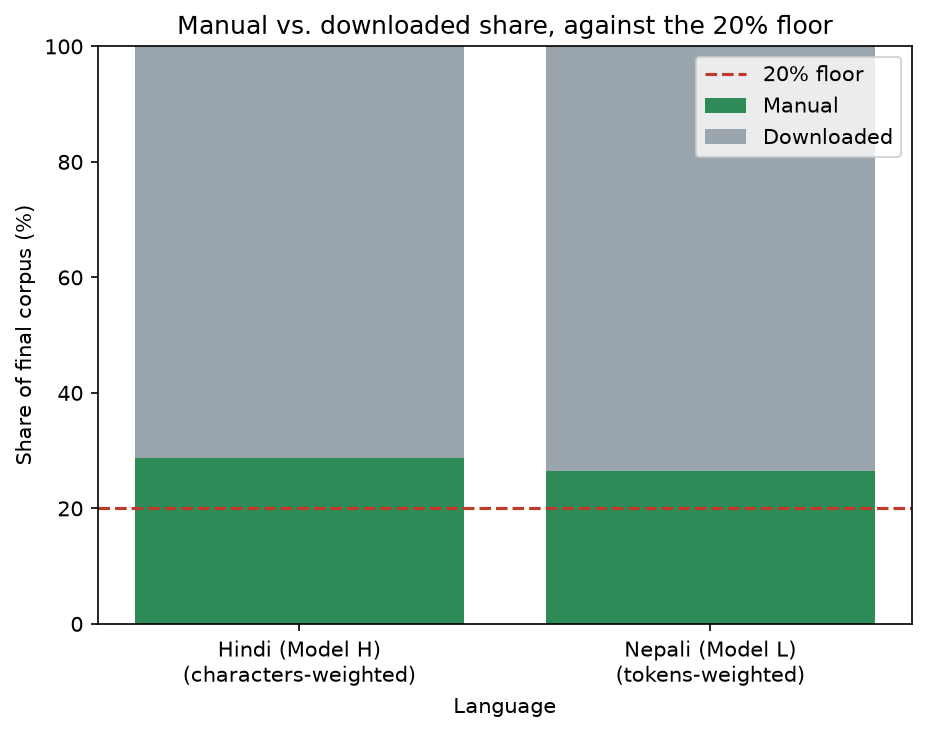

<div align="center">

# Language Models and Agents — Individual Project

**Two independent, from-scratch, decoder-only Transformer language models, one per Indian language.**


</div>

Per the course spec, the two models do **not** share data, tokenizer,
vocabulary, or weights — each language's pipeline lives in its own
self-contained directory (`hindi/`, `nepali/`) and is run independently
end to end. Hindi and Nepali also run on two structurally different
*pipelines* (Hindi: a single-pass cleaner; Nepali: a stage-based S00–S14
pipeline with MinHash/LSH dedup and absolute per-lane token targets), so
most of the linked report describes each language separately rather than
forcing one shared table.

**[Full Phase 1 report](report/phase1/phase1_report.md)** ([LaTeX](report/phase1/phase1_report.tex) · [PDF](report/phase1/phase1_report.pdf)) · **[Deliverables index](report/phase1/README.md)**

---

## At a glance

| | Hindi — Model H | Nepali — Model L |
|---|---:|---:|
| Pipeline | single-pass cleaner | stage-based, S00–S14 |
| Raw docs | 773,606 | ~2,655,504 (pre-clean) |
| Final docs | 704,101 | 1,918,265 |
| **Total tokens** | **505,852,028** | **635,204,333** |
| **% of 500M target** | **101.2%** | **127.0%** |
| Manual share | 28.65% char / 30.66% token | 26.41% token |
| Splits (train / val / test) | 675,937 / 14,082 / 14,082 | 1,520,000 / 199,428 / 198,837 |
| Tokenizer | SentencePiece **Unigram**, **8,000** | SentencePiece **BPE**, **10,000** |
| Leakage check | no overlap | no overlap |
| Cross-language check | 0 shared docs vs. Nepali | 0 shared docs vs. Hindi |

<div align="center">


</div>

All 10 required figures (both languages, one series/subplot per language)
are in [`report/phase1/figures/`](report/phase1/figures/) and embedded in
the [full report](report/phase1/phase1_report.md).

### Token counts, full breakdown

| | Hindi (Model H) | Nepali (Model L) |
|---|---:|---:|
| Train tokens | 485,280,741 | 519,906,359 |
| Validation tokens | 10,484,640 | 57,839,396 |
| Test tokens | 10,086,647 | 57,458,578 |
| **Total tokens** | **505,852,028** | **635,204,333** |
| **% of ~500M target** | **101.2%** | **127.0%** |
| Manual tokens | 155,104,651 | 167,787,251 |
| Manual share (token-weighted) | 30.66% | 26.41% |
| Clears 20% manual floor? | Yes | Yes |

Every number above is exact and unsampled — every train/val/test document
was actually tokenized and counted, not estimated from a sample.

---

## Phase 1 — Dataset Collection & Tokenizer Construction (complete)

`scripts/validate_phase1.py` reports **ALL CHECKS PASSED** for Hindi.
`scripts/validate_phase1_nepali.py` (Nepali's own parallel validator, since
its pipeline/data layout differs from Hindi's) reports **ALL CHECKS
PASSED** for Nepali except the cross-language check, which it deliberately
flags `SKIPPED` rather than running inline (too large — ~9.2GB — to check
as a validator side effect). That check was run separately —
`scripts/check_nepali_hindi_overlap.py` — result: **0 shared documents**,
recorded in [`phase1_report.md` §3](report/phase1/phase1_report.md).

### Deliverables

| # | Deliverable | Where |
|---|---|---|
| 1 | Dataset collection scripts (both languages) | `hindi/data/pipeline/{download_hindi.py, ingest_manual.py, ingest_wikipedia_dump.py}`; `nepali/scripts/{s01_collect.py, collect.py, auto_grow_and_tokenize.py, corpuslib/}` |
| 2 | Dataset preprocessing pipelines | `hindi/data/pipeline/clean_hindi.py`, `scripts/clean_lib.py` (shared); `nepali/scripts/{s03_normalize.py, s04_langid.py, s05_heuristics.py, s06_perplexity.py, s08_dedup.py, s09_decontaminate.py, s10_balance_lanes.py, s11_finalize_splits.py}` |
| 3 | Per-language dataset statistics reports | `report/phase1/phase1_report.{md,tex,pdf}` (both languages), `report/phase1/dataset_statistics.md`, `report/phase1/tokenizer_analysis.md` |
| 4 | Per-language train/validation/test splits | `hindi/data/splits/{train,validation,test}/` + manifests; `nepali/data/final/{train,val,test}.jsonl` + `split_stats.json` |
| 5 | Tokenizer training code | `hindi/tokenizer/train_tokenizer.py`; `nepali/scripts/{s12_train_tokenizer.py, s13_tokenizer_eval.py}` |
| 6 | Vocabulary files | `hindi/tokenizer/hindi_unigram_8000.vocab`; `nepali/tokenizer/nepali_bpe.vocab` (plus other swept sizes in `nepali/tokenizer/sweep/`) |
| 7 | Tokenizer model files | `hindi/tokenizer/hindi_unigram_8000.model`; `nepali/tokenizer/nepali_bpe.model` |

### Hindi (Model H)

**Resources, manual:** `hi_wikipedia_dump` (self-extracted Wikipedia XML
dump via WikiExtractor — largest single manual source), `gadya_kosh`
(prose wiki), `patrika_hindi` (newspaper archive), `kavita_kosh` (poetry
wiki), 67 misc. `archive.org` items (debate transcripts, books).
**Resources, downloaded:** `HuggingFaceFW/fineweb-2:hin_Deva`,
`ai4bharat/sangraha:unverified/hin`,
`ai4bharat/sangraha:verified/hin:{web,pdf,speech}`. Excluded: the
HF-mirrored `wikimedia/wikipedia:20231101.hi` (redundant with the
self-extracted dump — would not count as manual regardless).

### Nepali (Model L)

Nepali's pipeline gates on two **absolute** token targets rather than a
ratio: manual ≥ 100M, downloaded ≥ 400M — both cleared (manual 167.8M,
downloaded 467.4M).

**Resources, manual:** `news_onlinekhabar` (web scrape, 91.6% of manual
tokens), `wikipedia_api` (self-parsed XML dump), `news_bbc_nepali`,
`wikibooks_api`, `wiktionary_api`, `news_ekantipur`, `news_ratopati`,
`news_nagarik`, `ocr_archive_books`. **Resources, downloaded:**
`ai4bharat/sangraha` (`verified` + `unverified`), `ai4bharat/IndicCorpV2`.

> **Provenance note:** Nepali's pipeline was run on a separate machine
> (the ~30+ hour S08 MinHash dedup pass was impractical on the primary
> machine within the deadline window); only output artifacts were
> transferred into this repo, not live per-stage logs — `log.md`'s
> S08(production)–S14 entries are reconstructed from those artifacts,
> flagged inline as such.

---

## Repository layout

<details>
<summary>Click to expand</summary>

```
<repo>/
  README.md                    # this file
  requirements.txt
  hindi/
    data/
      raw/{manual,downloaded}/ # source text + metadata.jsonl (provenance)
      interim/                 # post-normalization, pre-language-filter snapshot
      cleaned/                 # final cleaned corpus
      splits/                  # train/validation/test (document-level split)
      metadata/                # clean_stats.json, dropped_documents.jsonl
      pipeline/                # download/ingest/clean/split scripts
    tokenizer/                 # SentencePiece model + vocab (Phase 1 deliverable)
    model/ train/ eval/ configs/   # Phase 2: Transformer, training,
                                 # evaluation, tests
  nepali/                      # Model L. Different pipeline shape (stage-based
                                # S00-S14 under scripts/, corpuslib/ shared lib)
                                # but the same required subfolders:
    data/raw/{manual,downloaded}/, data/final/{train,val,test}.jsonl
    tokenizer/                 # nepali_bpe.model/.vocab + sweep/
    model/ train/ eval/ configs/   # Phase 2: Transformer, training,
                                 # evaluation, tests
  scripts/                     # shared pipeline code (clean_lib.py, crawlers,
                                # validate_phase1.py, validate_phase1_nepali.py,
                                # check_nepali_hindi_overlap.py)
  report/
    phase1/                    # README.md (deliverables index), phase1_report.{md,tex,pdf}
                                # (both languages), dataset_statistics.md,
                                # tokenizer_analysis.md, make_plots.py, figures/
    phase2/ phase3/
  logs/                        # every *.log produced by the pipelines (gitignored)
  # bhojpuri/ removed — earlier, fully-complete Model L attempt,
  # superseded by Nepali; see "Bhojpuri (superseded)" below for its numbers
```

</details>

## Reproduction steps

<details>
<summary>Click to expand</summary>

**1. Environment**

```
python -m venv .venv
.venv/Scripts/activate      # or: source .venv/bin/activate
pip install -r requirements.txt
```

**2. Hindi pipeline**

```
python hindi/data/pipeline/download_hindi.py       # public/HF corpora -> raw/downloaded/
python hindi/data/pipeline/ingest_manual.py         # scraped/self-extracted sources -> raw/manual/
python hindi/data/pipeline/ingest_wikipedia_dump.py # self-extracted Wikipedia XML dump -> raw/manual/
python hindi/data/pipeline/clean_hindi.py           # raw/ -> interim/ -> cleaned/ (full rebuild by default)
python hindi/data/pipeline/split_hindi.py           # cleaned/ -> splits/{train,validation,test}/
python hindi/tokenizer/train_tokenizer.py --vocab-size 8000
```

`clean_hindi.py` always rebuilds `interim/`/`cleaned/` from `raw/` from
scratch; pass `--resume` only to continue an interrupted run without
reprocessing already-seen documents. `clean_hindi.py`/`split_hindi.py`
take an OS-level single-instance lock (`data/metadata/.clean.lock` /
`.split.lock`) — delete a stale lock older than 15 minutes if a run was
killed uncleanly.

**3. Nepali pipeline** (stage-based, config-driven — different shape from
Hindi's, see `nepali/scripts/` docstrings for each stage)

```
cd nepali/scripts
python s00_doctor.py                # environment/config sanity check
python auto_grow_and_tokenize.py    # full S02-S14: collect -> clean -> dedup ->
                                     # decontaminate -> balance -> split -> tokenize,
                                     # growing whichever lane (manual/downloaded) falls
                                     # short of its absolute token target, up to 4 rounds
```

Or run stages individually (`s01_collect.py` ... `s14_corpus_stats.py`) via
`python run_pipeline.py <stage>` for finer control. S08 (MinHash/LSH dedup
over ~2.2M documents) is the slow stage — budget several hours.

**4. Validate Phase 1 deliverables**

```
python scripts/validate_phase1.py            # Hindi
python scripts/validate_phase1_nepali.py     # Nepali (different data layout)
python scripts/check_nepali_hindi_overlap.py # cross-language: Nepali vs. Hindi
```

**5. Regenerate the report figures** (both languages, one script — it
live-measures each language's tokenizer sweep against its own held-out
validation split)

```
python report/phase1/make_plots.py
```

</details>

## Large artifacts (OneDrive)

Raw corpora, cleaned corpora, and tokenizer files are too large for git and
are hosted on OneDrive instead:

**[LMA DATA SET — shared OneDrive folder](https://iiithydstudents-my.sharepoint.com/:f:/g/personal/swaraj_kumar_students_iiit_ac_in/IgCh3u8O2sr4QIJqmrUS1CllAV1C5HL0R9SOWUUVIzTgcdw?e=bgUHaG)**
(requires an IIIT account with access)

### Key results (from the full report)

| | Hindi (Model H) | Nepali (Model L) |
|---|---:|---:|
| Total tokens (train+val+test, exact, unsampled) | **505,852,028** | **635,204,333** |
| % of ~500M target | **101.2%** | **127.0%** |
| Manual share, char-weighted | 28.65% | not tracked (see report §2) |
| Manual share, token-weighted | 30.66% | 26.41% |
| Clears 20% manual floor? | Yes | Yes |

## Hard constraints followed

No pretrained models, no pretrained tokenizers, no HuggingFace Transformer
model classes. Positional embeddings, multi-head attention, and causal
masking are student-implemented from primitive PyTorch layers (Phase 2). The
two language corpora, tokenizers, vocabularies, and (from Phase 2 onward)
model weights are fully independent — no sharing, no multilingual training.

---

## Phase 2 — Model Implementation, Pretraining & Evaluation (complete)

Two independent ~25M-parameter decoder-only Transformers, written from scratch
in PyTorch, pretrained on separate corpora with separate tokenizers, and
evaluated side by side.

**[Full Phase 2 report](report/phase2/phase2_report.md)** ·
**[Deliverables index](report/phase2/README.md)**

| | Model H (Hindi) | Model L (Nepali) |
|---|---:|---:|
| Total parameters | 23,273,472 | 24,297,472 |
| **Non-embedding parameters** | **18,915,328** | **18,915,328** |
| Layers / heads / d_model / d_ff | 6 / 8 / 512 / 2048 | 6 / 8 / 512 / 2048 |
| Context length | 512 | 512 |
| Training steps | 14,520 | 14,440 |
| Training tokens | 475,791,360 | 473,169,920 |
| Wall clock (Tesla T4) | 11.0 h @ 12.0k tok/s | 11.0 h @ 12.0k tok/s |
| **Validation perplexity** | **27.07** | 46.14 |
| **Test perplexity** | **27.41** | 46.68 |
| **Test bits-per-byte** | 0.5382 | **0.4846** |

The two models are identical in every architectural dimension except
vocabulary, so their non-embedding parameter counts match exactly and their
token budgets differ by 0.55% — any difference in results is attributable to
data and tokenizer, not to capacity or compute.

**The headline finding is that perplexity and bits-per-byte disagree.**
Perplexity favours Model H by 41%; bits-per-byte puts Model L marginally ahead.
Nepali's BPE-10000 packs 11.44 bytes per token against Hindi's Unigram-8000 at
8.88, so its tokens are individually harder to predict but carry more text.
Reporting perplexity alone would have supported the conclusion that the
lower-resource model is substantially worse; the tokenizer-neutral metric shows
they are close. See [the report](report/phase2/phase2_report.md) §4.

Both models independently converged on the same attention organisation,
including a previous-token head at layer 3 (entropy 0.06 at distance 1.3 for
Model H, 0.14 at 1.1 for Model L), with mean entropy about 2 nats below the
uniform-attention baseline of 5.256.

### Deliverables

| # | Deliverable | Where |
|---|---|---|
| 1 | Transformer (MHA, positional embeddings, causal mask) | [`hindi/model/transformer.py`](hindi/model/transformer.py), [`nepali/model/transformer.py`](nepali/model/transformer.py) |
| 2 | Model configuration files | [`hindi/configs/model.yaml`](hindi/configs/model.yaml), [`nepali/configs/model.yaml`](nepali/configs/model.yaml) |
| 3 | Parameter counts; training scripts; checkpoints | report §1; `*/train/train.py`; Drive links below |
| 4 | Training logs and loss curves | `report/phase2/*_training_log.jsonl`, `figures/loss_curves_both*.png` |
| 5 | PPL / BPB tables; BLEU, chrF, ROUGE-L | report §4–5, `report/phase2/*_eval.json` |
| 6 | Generated samples; diversity / repetition | report §5.2, `*_eval.json` → `generation.samples` |
| 7 | Attention heatmaps; entropy / distance | `figures/*_attention_layer{0,5}.png`, `figures/attention_summary_both.png`, `*_attention.json` |
| 8 | Resource-level comparison write-up | report §7 |

### Reproduction

Every command names exactly one language; no entry point runs both.

```
python hindi/data/pack_corpus.py            # Phase 1 splits -> uint16 streams
python nepali/data/pack_corpus.py

python hindi/tests/test_model.py            # 9/9, incl. causal-mask proof
python nepali/tests/test_model.py

python -m hindi.train.train  --config hindi/configs/model.yaml
python -m nepali.train.train --config nepali/configs/model.yaml

python -m hindi.eval.evaluate  --checkpoint checkpoints/hindi/ckpt_best.pt  --split test
python -m nepali.eval.evaluate --checkpoint checkpoints/nepali/ckpt_best.pt --split test

python scripts/make_phase2_figures.py     --hindi-checkpoint checkpoints/hindi/ckpt_best.pt     --nepali-checkpoint checkpoints/nepali/ckpt_best.pt
```

Pretraining ran on Kaggle via
[`notebooks/kaggle_pretrain.ipynb`](notebooks/kaggle_pretrain.ipynb) (once per
language, GPU T4) with
[`notebooks/kaggle_evaluate.ipynb`](notebooks/kaggle_evaluate.ipynb) for
evaluation from a finished checkpoint.

### Phase 2 checkpoints

> **TODO — upload and paste links.** Each bundle is ~1.3GB and contains
> `ckpt_best.pt`, `ckpt_final.pt`, rolling step checkpoints, `config.yaml` and
> `training_log.jsonl`. Every checkpoint carries model weights, optimizer
> state, scheduler state, step, tokens consumed and the full run config, so
> training resumes exactly. Permissions must be open so graders can download
> without requesting access.

| Model | Checkpoint bundle |
|---|---|
| Model H (Hindi) | _pending upload_ |
| Model L (Nepali) | _pending upload_ |

---

## What's next: Phase 3

### Phase 3 (due 16 Sep, final) — teach it to reason, then wrap up

- Build our **own** small dataset of comparison/reasoning questions
  (e.g. "A is taller than B, B is taller than C — who's tallest?") —
  written in Hindi and Nepali script, not English, and generated
  programmatically so we actually know the right answers.
- Finetune each pretrained model on its own language's reasoning data
  only — keep the tokenizer fixed, don't mix languages.
- Measure how much accuracy improved from pretrained → finetuned, and
  whether the attention patterns changed after finetuning.
- Write the final report tying it all together: how Hindi (more data) and
  Nepali (less data, different tokenizer) actually compare, and what
  factors explain the gap.

---

## Bhojpuri (superseded)

<details>
<summary>Click to expand — Bhojpuri was this project's original Model L</summary>

Bhojpuri was the original Model L: fully built, cleaned, split, tokenized,
and passing every `validate_phase1.py` check, with a documented,
spec-permitted 16.8%-of-target shortfall (84,217,032 tokens). It was
superseded by **Nepali** once Nepali's own pipeline cleared both its
absolute token targets — see [`phase1_report.md` §6](report/phase1/phase1_report.md)
for the full history and Bhojpuri's numbers.

Its tracked pipeline code and tokenizer files (`bhojpuri/`) have since
been removed from the repository; `bhojpuri/data/` (the large, already-
gitignored raw/cleaned corpus) was never tracked in git regardless. Its
measured numbers remain in `phase1_report.md` as the historical record.

`nepali/scripts/`, `nepali/configs/` (the pipeline code) are versioned in
this repository; `nepali/data/` (~20GB of raw/interim/final pipeline
output) is not, for the same "code in git, corpus data elsewhere" reason.

</details>
