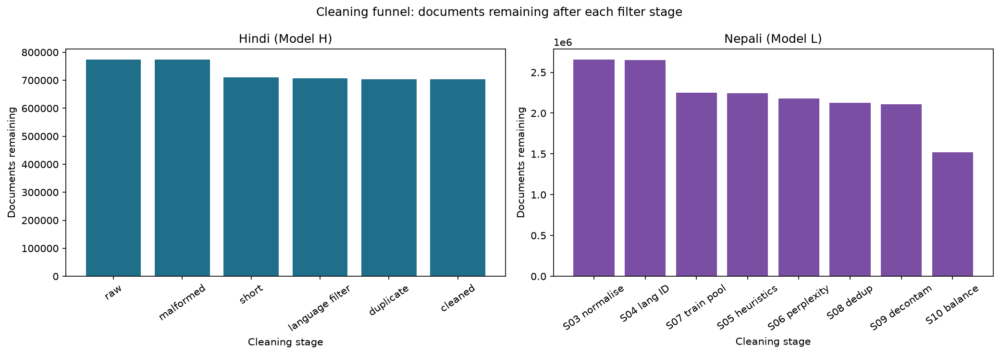
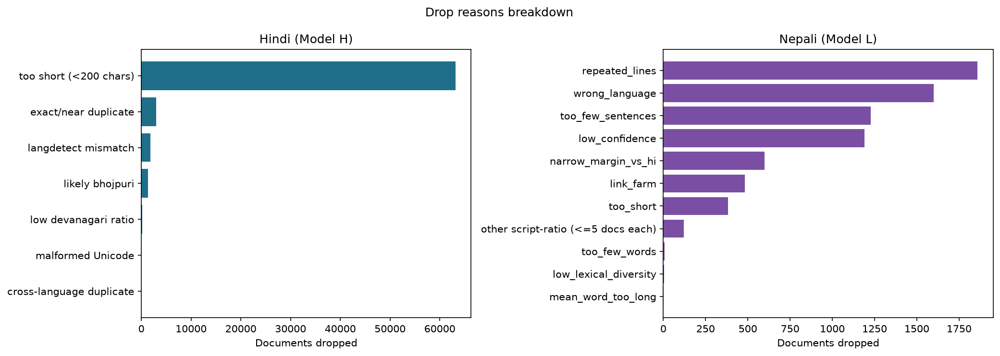
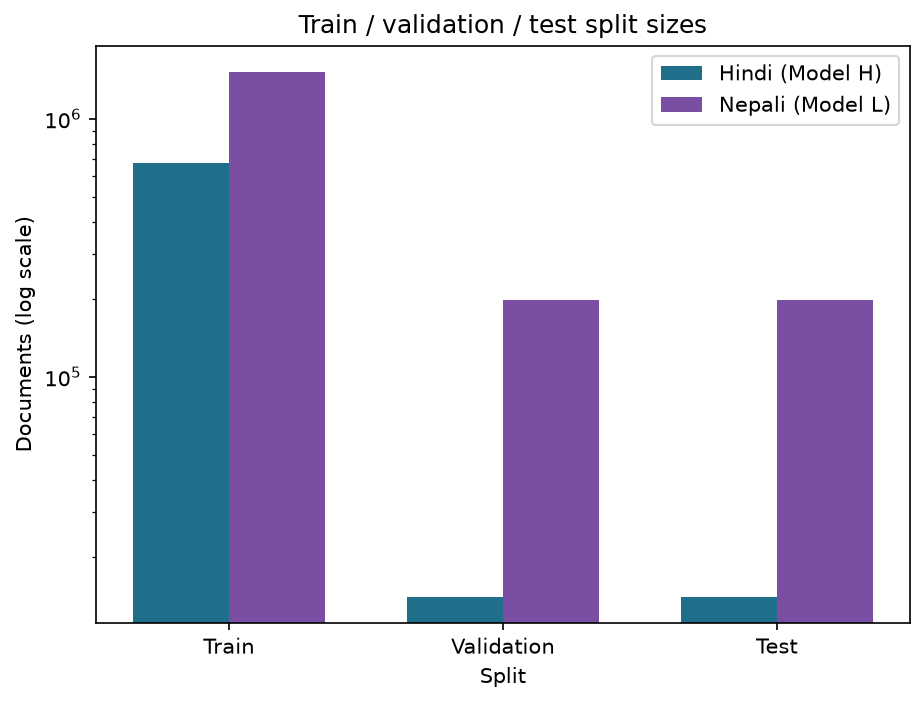
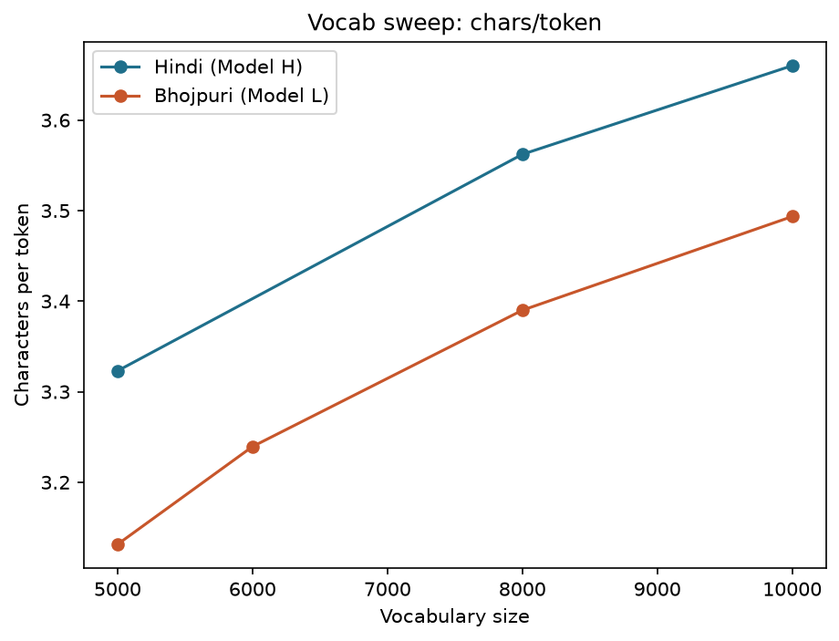
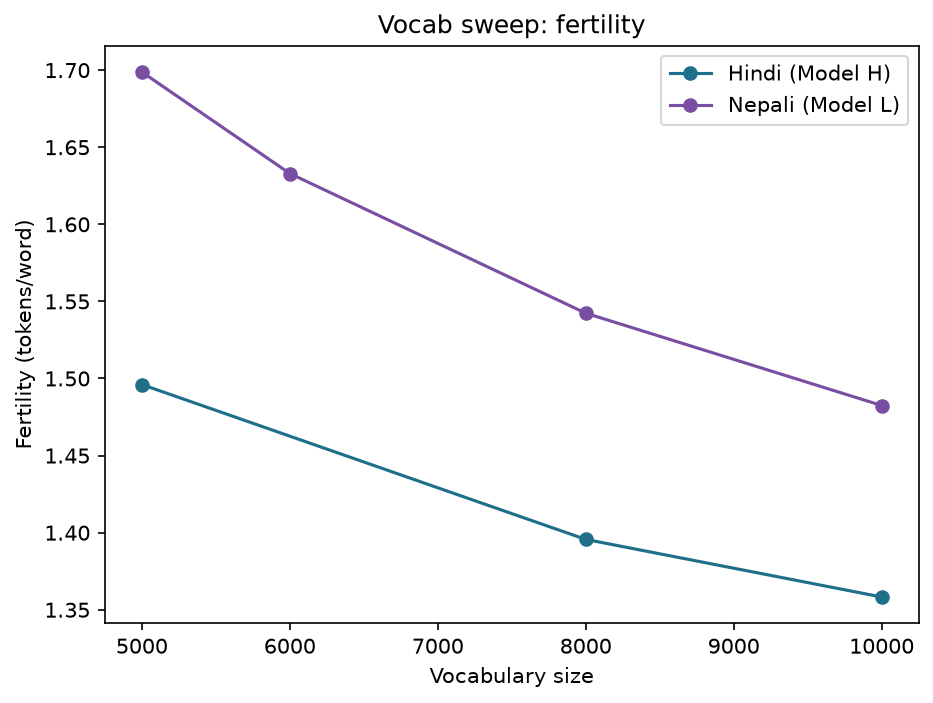
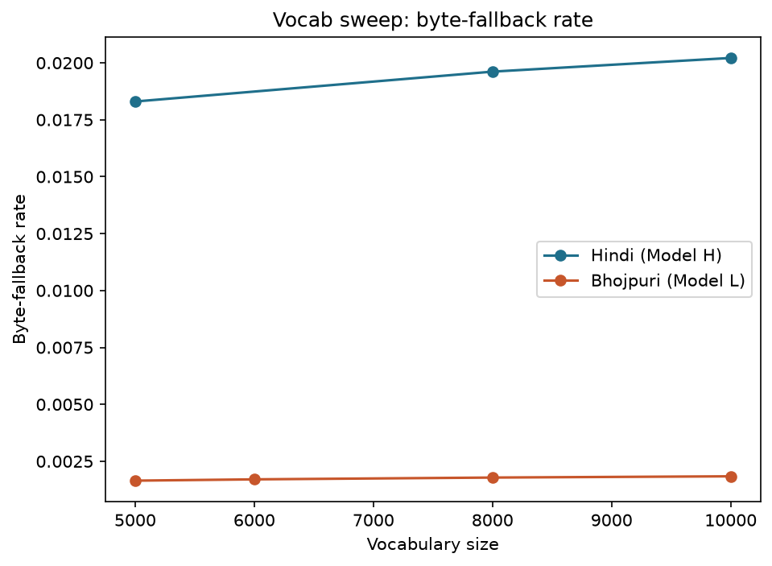
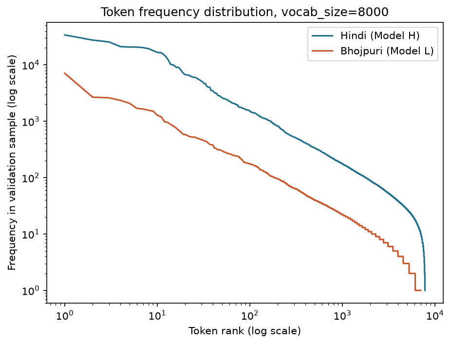
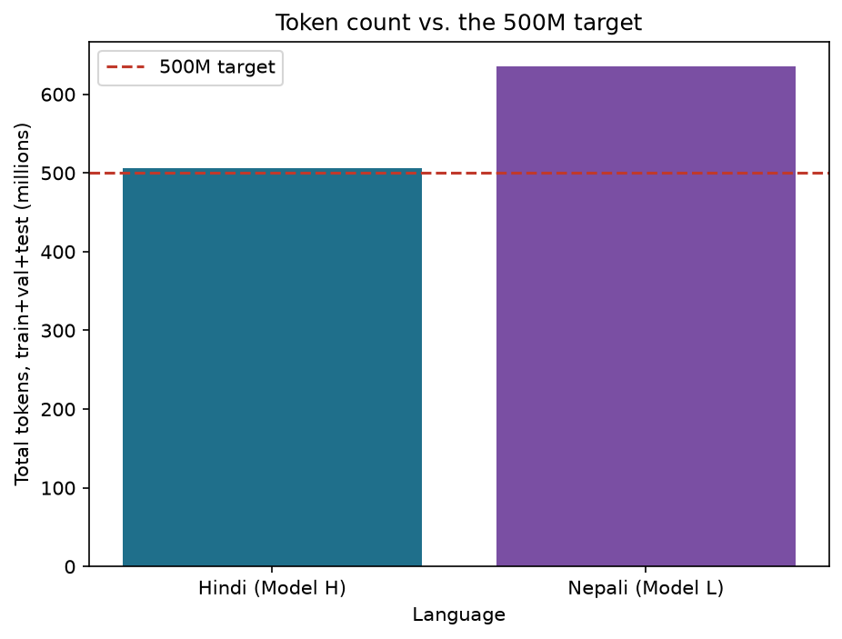

# Phase 1 Report — Data Collection & Tokenizer Construction

**Model H: Hindi. Model L: Bhojpuri.** This report covers Phase 1 only:
dataset collection, cleaning, splitting, and tokenizer construction for both
models. Every number below is read from a file on disk — `clean_stats.json`,
`hindi_pipeline_manifest.json`, `validate_final.log`, the trained tokenizer
`.model` files re-measured directly, or `report/phase1/measured_tokenizer_metrics.json`
(written by `report/phase1/make_plots.py`, which also produced every figure
below). Where a number was not measured, it is written as **NOT YET
MEASURED**, never estimated. Figures are regenerated by running:

```
.venv/Scripts/python.exe report/phase1/make_plots.py
```

---

## 1. Overview

The assignment requires two independent, from-scratch decoder-only
Transformer language models in two different Indian languages: Model H from
a higher-resource language, Model L from a fixed list of lower-resource
languages. Both must be built with fully separate data, tokenizer,
vocabulary, and (from Phase 2) weights — no sharing, no multilingual
training.

**Model H is Hindi.** Hindi is one of the highest-resource Indian languages
for NLP: Wikipedia, curated corpora like AI4Bharat's Sangraha, and
web-crawled corpora like Fineweb-2 all have large Hindi partitions. This
makes it realistic to reach the assignment's ~500M-token planning target
almost entirely from public sources, while still requiring genuine manual
collection to clear the 20% floor.

**Model L is Bhojpuri**, chosen from the assignment's allowed low-resource
list (Assamese, Bhojpuri, Bodo, Dogri, Konkani, Maithili, Manipuri, Mizo,
Nepali, Sindhi). Bhojpuri is spoken by tens of millions of people but has
very little curated NLP data: most available corpora are small, scattered,
or web-crawled with heavy noise. This makes Bhojpuri a genuine test of the
assignment's manual-collection requirement — public sources alone do not
come close to 500M tokens, so the manual share matters more here by
necessity, not just by rule.

Both languages are Devanagari-script, which lets the cleaning and
tokenization code share logic (`scripts/clean_lib.py`) while keeping every
byte of data, every trained model file, and every decision fully separate
per language.

---

## 2. Data collection

### What counts as "manual" under the course ruling

A source counts as **manual** only if it required work beyond pointing a
downloader at an existing public dataset: a self-run scrape, a personally
extracted Wikipedia XML dump, OCR from a physical or scanned source, or
similarly hands-on collection. A dataset that is just *labeled* as
Wikipedia-derived on Hugging Face does not count — even though the
underlying text originates from Wikipedia, using the HF-hosted mirror is a
download, not manual collection.

Concretely: `hi_wikipedia_dump` is the **self-extracted** Hindi Wikipedia XML
dump, run through WikiExtractor by this project — it counts as manual.
`wikimedia/wikipedia:20231101.hi`, the HF-mirrored parquet of the same
underlying Wikipedia content, does **not** count as manual, and using both
would double-count Wikipedia in two different lanes with two different
`source_type` labels for the same underlying text. It was moved to
`hindi/data/raw/_quarantined_hf_hiwiki_mirror/` and excluded from cleaning
entirely.

### Hindi (Model H) raw sources

| | Docs | Characters |
|---|---:|---:|
| Manual | 229,011 | 540,367,035 |
| Downloaded | 544,595 | 1,299,990,112 |
| **Total raw** | **773,606** | **1,840,357,147** |

**Manual sources:**

| Source | Docs | Characters | Collection method |
|---|---:|---:|---|
| hi_wikipedia_dump | 160,591 | 234,096,553 | self-extracted Wikipedia XML dump (WikiExtractor) |
| gadya_kosh | 21,481 | 197,490,954 | scrape + clean (prose wiki) |
| patrika_hindi | 16,251 | 73,759,826 | scrape + clean (patrika.com newspaper archive) |
| kavita_kosh | 30,621 | 23,610,585 | scrape + clean (poetry wiki) |
| archive.org (misc, 67 items) | 67 | 11,409,117 | OCR/text extraction — Rajya Sabha/Lok Sabha debate transcripts, religious texts, misc books |

**Downloaded sources:**

| Source | Docs | Characters |
|---|---:|---:|
| HuggingFaceFW/fineweb-2:hin_Deva | 217,460 | 500,000,289 |
| ai4bharat/sangraha:unverified/hin | 191,987 | 500,000,700 |
| ai4bharat/sangraha:verified/hin:web | 118,785 | 230,941,855 |
| ai4bharat/sangraha:verified/hin:pdf | 16,120 | 67,642,616 |
| ai4bharat/sangraha:verified/hin:speech | 243 | 1,404,652 |

**Excluded:** `wikimedia/wikipedia:20231101.hi` (163,091 docs / 253.3M
chars) — the HF-hosted Hindi Wikipedia mirror, quarantined to avoid
double-counting against the self-extracted dump above, and because it would
not count as manual regardless.

*Note on the raw total:* `hindi/data/metadata/clean_stats.json`'s own
`chars_in` (what `clean_hindi.py` measured as its input) reads
1,840,356,619 — 528 characters (0.00003%) less than the 1,840,357,147 sum of
the per-source table above. Both figures are real, independently-collected
measurements (one at ingestion/tagging time, one at cleaning time); the gap
is negligible and not investigated further given its scale.

### Bhojpuri (Model L) raw sources

| | Docs | Characters |
|---|---:|---:|
| Manual | 47,958 | 90,781,624 |
| Downloaded | 560,305 | 227,825,102 |
| **Total raw** | **608,263** | **318,606,726** |

**Manual sources:**

| Source | Docs | Characters | Collection method |
|---|---:|---:|---|
| khabar_bhojpuri | 22,175 | 39,169,105 | scrape + clean |
| anjoria | 13,556 | 21,750,949 | scrape + clean |
| bho_wikipedia_dump | 8,539 | 6,101,826 | self-extracted Wikipedia XML dump (WikiExtractor) — not the HF-mirrored parquet |
| jogira | 3,085 | 6,595,231 | scrape + clean |
| archive.org (misc, 88 items) | 88 | 16,210,212 | OCR/text extraction — books, journals, government debate transcripts, dictionaries |
| harsh_scraped_manual | 290 | 724,804 | prior personally-collected scrape (verified own work) |
| sirijan | 225 | 229,497 | scrape + clean |

All four dedicated crawl sources (khabar_bhojpuri, anjoria, jogira, sirijan)
were recrawled uncapped and confirmed exhausted (0–7 new docs on the final
pass) — there is no more to collect from them, not just a stopping point.

**Downloaded sources** (17 datasets/partitions; largest four shown, full
list in `report/phase1/dataset_statistics.md`):

| Source | Docs | Characters |
|---|---:|---:|
| Satyam810/BhojpuriCorpus:fish_food | 215,813 | 22,728,391 |
| harsh_indiccorp (personal prior collection, sentence-chunked) | 69,433 | 92,803,579 |
| Satyam810/BhojpuriCorpus:jnu_bhltr | 79,884 | 7,099,650 |
| Satyam810/BhojpuriCorpus:hplt | 17,778 | 45,689,298 |

**Excluded / failed sources, with reasons:**

| Source | Reason |
|---|---|
| bhojpuriplanet.com | domain expired |
| bhojpuri.blog | DNS-unregistered |
| CulturaX, sil-ai/bloom-lm | gated behind an authenticated HF token |
| AI4Bharat Sangraha, Glot500 | zero Bhojpuri rows in the current release |
| MADLAD-400 | no `bho`/`bho_Deva` config |
| CC-100 | legacy `datasets`-library script format, no longer supported by the current library version |

**Open item, not resolved, documented rather than hidden:** the BHLTR
corpus (`bhltr_monolingual`/`bhltr_monolingual_v02`, git-cloned directly
from JNU) likely overlaps with `Satyam810/BhojpuriCorpus:jnu_bhltr`, which
redistributes the same underlying corpus under a different source label.
The two are not deduplicated against each other by source name specifically
— but the pipeline's content-hash dedup (`dedup_key`, see Section 3) still
catches any exact-text overlap between them regardless of label, so this is
a labeling ambiguity, not a known leak.

*Note on the raw total:* the same kind of small gap exists here —
`clean_stats.json`'s `chars_in` reads 318,528,901, 77,825 characters
(0.024%) below the 318,606,726 source-table sum, for the same reason as
Hindi's gap above.

---

## 3. Cleaning pipeline

Both languages share one cleaning implementation, `scripts/clean_lib.py`,
run separately per language (`clean_hindi.py` / `clean_bhojpuri.py`) against
that language's own `raw/` tree only. The measured stage order, confirmed
below from `clean_stats.json`'s own checkpoints (not assumed from
documentation), is:

```
raw → malformed-Unicode removal → too-short removal → language-ID filter
    → exact/near-duplicate removal → cleaned
```

**Why this order is verified, not assumed:** `clean_stats.json` records a
mid-pipeline checkpoint, `docs_interim`, taken after malformed+short-doc
removal but before the language filter. For Hindi:
`docs_in (773,606) − dropped_malformed (17) − dropped_short (63,132) =
710,457 = docs_interim` exactly. Then
`docs_interim (710,457) − dropped_language (3,371) − dropped_duplicate
(2,983) = 704,103 = docs_cleaned` (pre-cross-language-correction figure —
see below). The same arithmetic holds exactly for Bhojpuri. This is why
Figure 3 draws the funnel in this order rather than the sequence a reader
might otherwise guess.

**Normalization: NFC, not NFKC.** Unicode NFC (canonical composition) is
used, not NFKC (compatibility composition). NFKC would strip or alter
U+200C (ZWNJ) and U+200D (ZWJ) — zero-width joiner/non-joiner characters
that look like formatting noise but are **semantically meaningful** in
Devanagari: they control whether a consonant cluster forms a conjunct
ligature or stays visually separate (e.g. controlling whether a script
renders a half-form or full-form of a letter). Stripping them would silently
corrupt real orthographic distinctions in both Hindi and Bhojpuri text. NFC
preserves them; only genuine zero-width/control characters unrelated to
Devanagari orthography are stripped separately.

**Latin-token removal, digits kept.** Both corpora had Latin-script tokens
(residual English words, URLs, markup fragments) stripped during cleaning —
Hindi: 8,016,102 Latin tokens removed; Bhojpuri: 1,576,446. Digits are kept,
since numerals are not script-specific noise the way stray Latin words are.

**Language filter.** `langdetect` has **no `bho` label** — it cannot itself
identify Bhojpuri text, and Hindi/Bhojpuri share vocabulary and script
closely enough that this is a real problem, not a theoretical one. The
project's approach, quoted directly from each language's `clean_stats.json`:

> Hindi (`bhojpuri_reject_caveat`): *"langdetect has no 'bho' label, so it
> cannot itself catch Bhojpuri text misclassified as Hindi (they share
> vocabulary and script). `dropped_language.likely_bhojpuri` is an active
> reject filter (see `clean_lib.marker_counts`/`language_ok` below), not
> just a count: any document where Bhojpuri lexical markers
> (बा/बाटे/बाड़ें/एगो/गइल/भइल/कइल/etc., ≥2 hits) outnumber Hindi markers
> (है/हैं/एक/गया/हुआ/किया/etc.) is dropped before reaching `data/cleaned/`.
> This is a coarse lexical heuristic, not a language model, so it will not
> catch every case — documented as a known limitation, not a solved
> problem."*

> Bhojpuri (`language_id_caveat`): *"langdetect has no 'bho' label;
> Devanagari-script-ratio was used as a practical proxy and cannot
> distinguish Bhojpuri from closely-related Hindi/Nepali text mislabeled at
> the source. `likely_hindi_contamination` is a coarse lexical-marker count
> (see `clean_lib.marker_counts`) among docs that otherwise passed cleaning
> — it is **NOT** a filter, documents counted here are still included in
> `data/cleaned/`. Flags docs where Hindi markers
> (है/हैं/एक/गया/हुआ/किया/आप/तुम्हारा) outnumber Bhojpuri markers
> (बा/बाटे/बाड़ें/एगो/गइल/भइल/कइल/etc.) by a clear margin."*

Concretely: on the Hindi side, `likely_bhojpuri` is an **active reject
filter** — 1,365 documents were dropped by it. On the Bhojpuri side,
`likely_hindi_contamination` (**11,164** documents) is reported as a
**measurement only** — those documents are still in `bhojpuri/data/cleaned/`,
flagged but not removed, because a coarse lexical-marker count is not
trusted enough on its own to delete data outright on that side of the
pipeline.

**This limitation is not hypothetical.** `scripts/validate_phase1.py`'s
cross-language check independently caught 2 documents whose content hash
was shared between the Hindi and Bhojpuri cleaned corpora. Inspection
confirmed both are genuinely Bhojpuri news text (containing verb forms like
"कहलन", "जइहें" not in Hindi's fixed marker list) that had been sourced as
`hin` by `ai4bharat/sangraha` while the same underlying text was correctly
labeled `bho_Deva` by `HuggingFaceFW/fineweb-2` — an upstream labeling
error, not a bug introduced by this pipeline. Both were removed from the
Hindi cleaned corpus (kept in Bhojpuri, where they linguistically belong):
`hi_downloaded_sangraha_e6bb7e97f6` and
`hi_downloaded_sangraha_unverified_7ca84f1c71`. This is why Hindi's final
cleaned count is **704,101**, not `clean_stats.json`'s own recorded
704,103 — that file predates this targeted, documented correction.

**Deduplication.** Exact-hash matching on normalized text
(`dedup_key`, `clean_lib.dedup_key`); on a tie between a manual-lane and a
downloaded-lane document, the **manual copy wins** and the downloaded
duplicate is dropped, so manual share is never eroded by cross-lane overlap
that dedup happens to catch. Near-duplicate detection beyond exact-hash
matching (e.g. MinHash/LSH) was **not** run on the Hindi/Bhojpuri pipelines
— see Section 8.

**Measured drop counts:**

| Reason | Hindi | Bhojpuri |
|---|---:|---:|
| Malformed Unicode | 17 | 23 |
| Too short (<200 chars) | 63,132 | 4,665 |
| Low Devanagari ratio | 228 | 1,501 |
| Likely Bhojpuri (active reject, Hindi only) | 1,365 | — |
| langdetect mismatch | 1,778 | — |
| Exact/near-duplicate | 2,983 | 94,080 |
| Cross-language duplicate (targeted correction) | 2 | 0 |
| **Total dropped** | **69,505** | **100,269** |
| **Docs in → cleaned** | 773,606 → 704,101 | 608,263 → 507,994 |

See **Figure 3** (cleaning funnel) and **Figure 4** (drop reasons ranked).





Too-short documents are by far the largest single loss for Hindi (63,132 of
69,505 total, 90.8%); for Bhojpuri, exact/near-duplicate is the largest
(94,080 of 100,269, 93.8%) — a large fraction of Bhojpuri's downloaded pool
(the several overlapping `Satyam810/BhojpuriCorpus` partitions) turned out
to share substantial exact-duplicate text once normalized.

---

## 4. Splits

Both languages split at the **document level**, seed 42, using
deterministic hashing of `document_id` so that the same document can never
land in two different splits and no split boundary depends on processing
order.

| | Hindi (train/val/test) | Bhojpuri (train/val/test) |
|---|---:|---:|
| Documents | 675,937 / 14,082 / 14,082 | 487,674 / 10,160 / 10,160 |
| Ratio | ~95.9% / 2.0% / 2.0% | ~96.0% / 2.0% / 2.0% |

`scripts/validate_phase1.py`'s leakage check — a `document_id` set
intersection across all three splits per language — reports **no overlap**
for both languages (`validate_final.log`, lines 10–11 and 20–21). See
**Figure 5**.



---

## 5. Tokenizers

### Why SentencePiece Unigram, not BPE

Both tokenizers are SentencePiece **Unigram**, trained separately per
language on that language's own `data/splits/train/` only — never
validation or test.

BPE builds a vocabulary by greedily merging the most frequent adjacent pair
of symbols, one merge at a time, with no mechanism to reconsider an earlier
merge once made. Unigram instead treats the *segmentation itself* as a
latent variable: it starts from a large candidate set of subword pieces,
then uses EM to iteratively re-estimate piece probabilities and prune the
candidate set down to the target vocabulary size, keeping whichever
segmentation of the training data is most probable under the current model
at each step.

This matters for Hindi and Bhojpuri specifically because both are
morphologically rich, agglutinative-suffixing languages layered on top of
Devanagari's conjunct-cluster orthography (a single visual glyph can
correspond to a multi-codepoint sequence forming a consonant conjunct).
BPE's greedy, order-dependent merging has no way to revisit a bad early
merge inside a conjunct cluster or a common suffix chain; Unigram's
probabilistic re-estimation can. This is a structural argument, not a
measured one for this project — no side-by-side BPE run was performed here
to confirm it empirically (see Section 8).

**The cost:** Unigram's suffix-array construction stage, needed to extract
candidate substrings before EM pruning, is memory-heavy. On this project's
16GB training machine, Hindi's suffix-array stage was the binding memory
constraint, peaking near 5.9GB — large enough that it shaped how much of
the corpus could be fed to the trainer at once (see the sampling note
below), though it did not require reducing `character_coverage` or other
quality-affecting settings.

### Full sweep table

Vocabulary range: **5,000–10,000**, swept at 5k/8k/10k (Hindi) and
5k/6k/8k/10k (Bhojpuri), per a course-TA ruling capping vocab size at this
range for a ~25M-parameter model (see "Embedding budget" below). An earlier
pass explored 12k/16k/24k before that ruling was issued; those model files
are not valid candidates and have been removed.

Every number below was **re-measured fresh** for this report by
`report/phase1/make_plots.py`, loading each trained `.model` file directly
and encoding the same held-out sample every existing measurement in this
project used: the first 2,000 non-empty documents from
`data/splits/validation/text/` in sorted-filename order (identical
methodology to `<lang>/tokenizer/analyze_tokenizer.py`). The fresh numbers
match `hindi_pipeline_manifest.json` and `bhojpuri_tokenizer_sweep.log`
exactly to 4+ decimal places — full agreement is what confirms these
are the same measurement, not two different ones that happen to be close.
Fresh measurement also gave exact `unused_ids` counts, which the published
logs only reported as a rounded percentage.

**Hindi:**

| Vocab | chars/token | fertility | UNK rate | byte-fallback rate | vocab coverage | unused ids |
|---:|---:|---:|---:|---:|---:|---:|
| 5,000 | 3.3230 | 1.4961 | 0.000000 | 0.018301 | 0.9654 | 173 |
| 8,000 | 3.5622 | 1.3956 | 0.000000 | 0.019613 | 0.9762 | 190 |
| 10,000 | 3.6601 | 1.3583 | 0.000000 | 0.020213 | 0.9767 | 233 |

**Bhojpuri:**

| Vocab | chars/token | fertility | UNK rate | byte-fallback rate | vocab coverage | unused ids |
|---:|---:|---:|---:|---:|---:|---:|
| 5,000 | 3.1314 | 1.6037 | 0.000000 | 0.001649 | 0.9230 | 385 |
| 6,000 | 3.2394 | 1.5502 | 0.000000 | 0.001706 | 0.9122 | 527 |
| 8,000 | 3.3900 | 1.4814 | 0.000000 | 0.001785 | 0.8776 | 979 |
| 10,000 | 3.4935 | 1.4375 | 0.000000 | 0.001840 | 0.8321 | 1,679 |

See **Figures 6–8**.







### Why UNK rate is meaningless here

UNK rate reads **exactly 0.0** at every vocab size for both languages. This
is not a sign the vocabulary covers everything — it is structural.
`byte_fallback=True` means any character sequence the model cannot
represent as a normal subword piece falls back to raw-byte pieces
(`<0xNN>` tokens) instead of the `<unk>` token. So UNK simply never fires;
the metric that actually tracks "how much of this text could the vocabulary
not represent normally" is the **byte-fallback rate**, not UNK rate. Hindi's
byte-fallback rate (1.83%–2.02% across the sweep) is roughly 11x Bhojpuri's
(0.16%–0.18%) — consistent with Hindi's more heterogeneous source mix
(newspapers, Wikipedia, government transcripts, web text) carrying more
varied punctuation and symbols than Bhojpuri's more uniform informal-web
sources.

### Vocab-size choice: 8,000 for both languages

**Measured trade-off.** For both languages, fertility improves with vocab
size but with diminishing returns, while vocab utilization (coverage)
degrades — a larger vocabulary means more embedding rows that are rarely or
never used on held-out text. Hindi's utilization is still high even at 10k
(97.67%, since Hindi's much larger and more diverse corpus keeps even a
large vocab well-used) — the opposite of the usual pattern — but the
*fertility* gain from 8k→10k (1.3956→1.3583, 2.7% relative) is much smaller
than the 5k→8k gain (1.4961→1.3956, 6.7% relative), for meaningfully more
embedding cost. Bhojpuri's utilization drops more sharply with vocab size
(92.3%→83.2% from 5k to 10k) since its smaller corpus has fewer distinct
subword forms to fill a larger vocabulary with.

**Embedding parameter budget.** At a ~25M-parameter total model with tied
input/output embeddings, the embedding table costs `vocab_size × model_dim`
parameters. The course-TA ruling that capped vocab at 5k–10k was stated as
"a 24k vocab makes the embedding table about 49% of the model" — this
corresponds almost exactly to `model_dim=512`:
`24,000 × 512 = 12,288,000 = 49.15%` of 25,000,000. Using that same
reference point:

| Vocab | Embed params (d=512) | % of 25M |
|---:|---:|---:|
| 8,000 | 4,096,000 | **16.38%** |
| 10,000 | 5,120,000 | 20.48% |
| ~~24,000~~ (ruled out) | 12,288,000 | 49.15% |

8,000 keeps the embedding table a clear minority of the 25M budget
(16.38%) with only a small step up from 5,000 (10.24%), while 10,000
already starts eating a meaningfully larger share (20.48%) for a fertility
gain that has mostly already been captured by 8,000.

**Both signals agree, independently, for both languages:** 8,000 sits at
the point where most of the achievable fertility/utilization gain over
5,000 is already captured, before the embedding cost of 10,000 stops paying
for itself. Measured directly rather than inferred: **8,000 produces more
total tokens than 10,000 for Hindi** (505,852,028 vs. 491,883,387 — a
smaller vocab means more tokens for the same text), pushing Hindi to 101.2%
of the 500M target versus 10,000's 98.4%.

### Sample tokenizations (real script output, vocab_size=8,000)

**Hindi** (`hindi_analyze_8000_final.log`):

```
text:   अतुल माहेश्वरी के निधन के कई महीनों बाद अमर उजाला में...
pieces: ['▁अ', 'तुल', '▁माह', 'ेश्वर', 'ी', '▁के', '▁निधन', '▁के', ...]
ids:    [357, 4081, 1847, 1993, 279, 259, 3143, 259, ...]

text:   नई दिल्ली
pieces: ['▁नई', '▁दिल्ली', '<0x0A>', 'नर', 'ेंद्र', '▁मोदी', ...]
ids:    [648, 513, 13, 1796, 2061, 713, ...]

text:   दिल्ली: अदालत ने सैयद अहमद बुखारी के तर्क को बताया...
pieces: ['▁दिल्ली', ':', '▁अदालत', '▁ने', '▁सैयद', '▁अहमद', ...]
ids:    [513, 388, 1802, 273, 7550, 3344, ...]
```

**Bhojpuri** (`bhojpuri_tokenizer_sweep.log`, vocab_size=8000 block):

```
text:   कांग्रेस अब आरोप थोपो पार्टी बन कर रह गई है।
pieces: ['▁कांग्रेस', '▁अब', '▁आरोप', '▁', 'थो', 'पो', '▁पार्टी', ...]
ids:    [680, 346, 1011, 263, 4466, 1263, 707, ...]

text:   तूने जो कौड़ियां भेंट दी हैं वे किसकी दी हुई हैं।
pieces: ['▁तू', 'ने', '▁जो', '▁कौ', 'ड़िया', 'ं', '▁भेंट', ...]
ids:    [661, 403, 706, 2714, 3049, 308, 2037, ...]

text:   कांग्रेसियन के आवे वाला पीढ़ी ले निश्चिंत बा कि ओकर...
pieces: ['▁कांग्रेस', 'ियन', '▁के', '▁आवे', '▁वाला', '▁पीढ़ी', ...]
ids:    [680, 494, 259, 544, 320, 3583, ...]
```

See **Figure 9** for how these individual pieces fit into the whole
vocabulary's usage distribution.



Both languages show the expected Zipf-shaped curve: a small number of
pieces (common postpositions like ▁के/▁में/▁से, punctuation) account for a
large share of all tokens emitted, with a long tail of rare pieces.
Bhojpuri's curve sits below Hindi's at every rank because its validation
sample has fewer total tokens (2.09M vs. Hindi's much larger validation
split content), not because its vocabulary is less concentrated — the
*shape* of the two curves, not their vertical offset, is what is
comparable here.

### Training sample size — stated plainly

SentencePiece does not train on the entire train split for either
language. It uses `input_sentence_size=2,000,000` with
`shuffle_input_sentence=True`, which reservoir-samples up to 2,000,000
sentences (after flattening the corpus one sentence per line) from the full
train split.

| Language | Chars used for training | Train split total chars | Fraction sampled |
|---|---:|---:|---:|
| Hindi | 372,725,734 (5k) / 372,681,654 (8k) / 372,709,882 (10k) | 1,692,881,268 | 22.0% |
| Bhojpuri | 217,511,027 | 271,000,251 | 80.3% |

This is SentencePiece's standard, documented mechanism for bounding
training cost on a large corpus — its own trainer log warns "Too many
sentences are loaded" and recommends exactly this option once sentence
count exceeds the cap, which is why it is used here rather than an ad hoc
truncation. Hindi's train split has far more sentences than Bhojpuri's for
the same 2,000,000-sentence cap, so a much smaller fraction of it is used
per training run — expected, and not a bias concern, because the sample is
a random shuffled draw across the *entire* corpus, not the first N
characters or a single source. The held-out evaluation in the sweep table
above is run separately, on the validation split, so it measures the
trained tokenizer's real generalization regardless of how much of train it
saw while fitting. The full-corpus token counts in Section 6 are exact and
unsampled — every train, validation, and test document is actually encoded.

---

## 6. Results

**Hindi:** 505,852,028 total tokens (train 485,280,741 + validation
10,484,640 + test 10,086,647) — **101.2% of the ~500M target**, exceeding
it. Manual share: **28.65% char-weighted** (505,509,566 /
1,764,596,782 cleaned characters), **30.66% token-weighted** (155,104,651 /
505,852,028 tokens). Both clear the 20% floor with a comfortable margin.

**Bhojpuri:** 84,217,032 total tokens (train 80,610,590 + validation
2,085,234 + test 1,521,208) — **16.8% of the ~500M target**. Manual share:
**28.59% char-weighted** (80,843,912 / 282,815,177 cleaned characters),
**29.89% token-weighted** (25,169,871 / 84,217,032 tokens). Both clear the
20% floor.

See **Figure 10**.



**Bhojpuri's shortfall against the 500M target is expected and
spec-permitted, not a gap in collection effort.** The assignment explicitly
allows the lower-resource model to fall short of the 500M-token planning
target "if it cannot reach 500M from public sources," provided the shortfall
is honestly documented rather than padded or duplicated to fake the number
(no padding or duplication was done here — see Section 3's dedup coverage).
All four dedicated Bhojpuri manual crawl sources were recrawled uncapped and
confirmed exhausted; every Bhojpuri-labeled dataset findable on Hugging Face
was evaluated (six were rejected as unusable, with reasons, in Section 2).
For scale: published prior Bhojpuri monolingual resources are, at most, on
the order of a 45,000-sentence corpus (JNU BHLTR) and a roughly
169,000-word web-crawled corpus — this project's 282.8M-character cleaned
corpus is orders of magnitude larger than anything previously publicly
available for this language. 84.2M tokens is close to the ceiling of what
is currently collectible for Bhojpuri, not a shortfall relative to what was
achievable.

---

## 7. Reproducibility

| | Value |
|---|---|
| Split seed | 42 (both languages, document-level) |
| Tokenizer training seed / determinism | SentencePiece `shuffle_input_sentence=True` (see Section 5 for the sampling mechanism) |
| Git commit (Hindi pipeline, per `hindi_pipeline_manifest.json`) | `0b0012ecb3deb08b61a81cc6e989c9bc60289a31` |
| Python | 3.14.0 |
| sentencepiece | 0.2.2 |
| Platform | Windows-11-10.0.26200-SP0 |

**To rerun a stage** (per language, `<lang>` = `hindi` or `bhojpuri`; see
the repository root `README.md` for the full command sequence):

```
python <lang>/data/pipeline/download_<lang>.py       # public/HF corpora
python <lang>/data/pipeline/ingest_manual.py          # scraped/self-extracted sources
python <lang>/data/pipeline/ingest_wikipedia_dump.py  # self-extracted Wikipedia XML dump
python <lang>/data/pipeline/clean_<lang>.py           # raw/ -> interim/ -> cleaned/
python <lang>/data/pipeline/split_<lang>.py           # cleaned/ -> train/validation/test
python <lang>/tokenizer/train_tokenizer.py --vocab-size 8000
python scripts/validate_phase1.py                     # PASS/FAIL per check
python report/phase1/make_plots.py                    # regenerate every figure in this report
```

**Large artifacts** (raw corpora, cleaned corpora, tokenizer files — too
large for git) are hosted on OneDrive:
[LMA DATA SET — shared OneDrive folder](https://iiithydstudents-my.sharepoint.com/personal/swaraj_kumar_students_iiit_ac_in/_layouts/15/onedrive.aspx?id=%2Fpersonal%2Fswaraj%5Fkumar%5Fstudents%5Fiiit%5Fac%5Fin%2FDocuments%2FLMA%20DATA%20SET&ga=1)
(requires an IIIT account with access) — see the repository root
`README.md`'s artifact table for current upload status.

---

## 8. Limitations and what I would do differently

- **The language-ID proxy is a real, acknowledged weak point.** `langdetect`
  has no Bhojpuri label at all, so both directions of this problem
  (Bhojpuri text mislabeled as Hindi, and vice versa) are handled by coarse
  Devanagari-script-ratio plus hand-picked lexical markers, not a trained
  classifier. It is asymmetric by design: Hindi's `likely_bhojpuri` is an
  active reject filter, Bhojpuri's `likely_hindi_contamination` is only a
  measurement. `scripts/validate_phase1.py`'s cross-language content-hash
  check caught 2 real misses this heuristic let through — there are almost
  certainly more that a hash-based check cannot catch (paraphrased or
  non-duplicated contamination would not trigger it). Given more time, this
  would be the first thing to replace with a real trained classifier, not a
  marker list.
- **SentencePiece training samples the corpus, most aggressively for
  Hindi** (22.0% of train characters, vs. Bhojpuri's 80.3%). This is
  standard practice and does not bias the *held-out evaluation* numbers in
  Section 5 (measured separately, on validation text the tokenizer never
  saw during training either way), but it does mean the trained model saw
  under a quarter of Hindi's train split's characters. A higher
  `input_sentence_size` (at the cost of more suffix-array memory, already
  the binding constraint on this machine at ~5.9GB) would let more of the
  corpus inform the vocabulary directly.
- **Near-duplicate detection beyond exact-hash matching was cut for time.**
  Both languages only dedup on an exact normalized-text hash
  (`dedup_key`). Near-duplicate documents that differ by a few words,
  reformatting, or partial overlap are not caught by this. Given
  Bhojpuri's downloaded pool includes several overlapping
  `Satyam810/BhojpuriCorpus` partitions (flagged as an open item in Section
  2) and the BHLTR/jnu_bhltr overlap, a MinHash/LSH near-duplicate pass —
  the kind of approach this project's cost/benefit did not justify running
  to completion within the Phase 1 timeline — would likely find more
  duplication than the exact-hash pass did, especially in Bhojpuri's web-
  crawled downloaded sources.
- **The BPE-vs-Unigram choice for this project's morphology argument (Section
  5) is structural, not empirically confirmed here.** No side-by-side BPE
  sweep was run on this data to measure whether Unigram's advantage on
  agglutinative suffixing and Devanagari conjuncts actually shows up as a
  measurable fertility or utilization difference for Hindi/Bhojpuri
  specifically, versus being a general property that may or may not matter
  much at this vocab-size range. Worth running as a check before Phase 2
  commits further to this tokenizer.
- **The two raw-total discrepancies noted in Section 2** (Hindi: 528
  characters, 0.00003%; Bhojpuri: 77,825 characters, 0.024%, both between
  the per-source breakdown sum and `clean_stats.json`'s own `chars_in`)
  were not root-caused. Both are small enough not to affect any pass/fail
  check in this report, but the actual cause (a handful of documents
  counted slightly differently between the ingestion-time tagging pass and
  the cleaner's own read) was not tracked down.
