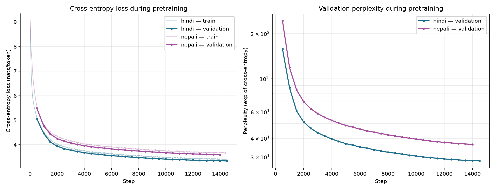
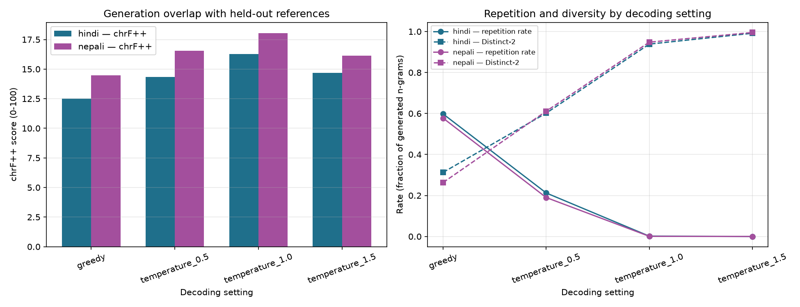
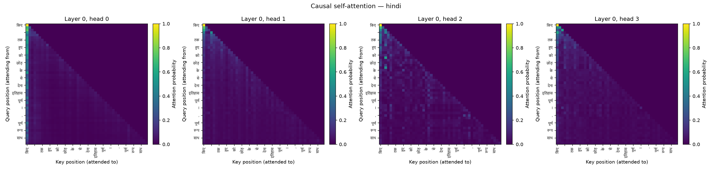
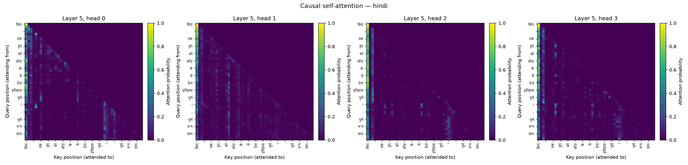
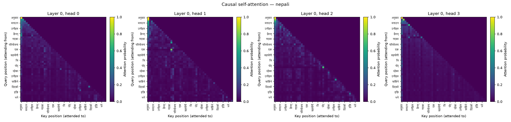
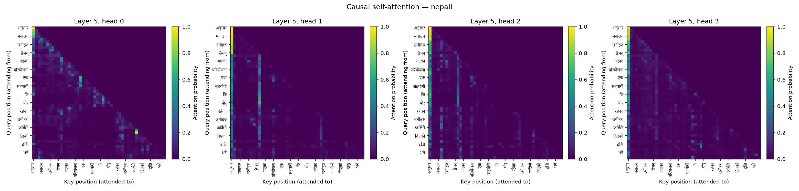

# Phase 2 — Model Implementation, Pretraining, and Evaluation

**Model H = Hindi (higher-resource) · Model L = Nepali (lower-resource)**

Two independent ~25M-parameter decoder-only Transformers, written from scratch
in PyTorch, pretrained on separate monolingual corpora with separate tokenizers
and vocabularies, and evaluated side by side.

---

## 1. Headline results

| | Model H (Hindi) | Model L (Nepali) |
|---|---:|---:|
| Vocabulary (Phase 1) | 8,000 Unigram | 10,000 BPE |
| Total parameters | 23,273,472 | 24,297,472 |
| **Non-embedding parameters** | **18,915,328** | **18,915,328** |
| Training steps completed | 14,520 | 14,440 |
| Training tokens | 475,791,360 | 473,169,920 |
| Wall clock (Tesla T4) | 11.0 h @ 12.0k tok/s | 11.0 h @ 12.0k tok/s |
| Evaluated checkpoint | step 14,500 | step 14,000 |
| Validation cross-entropy | 3.2985 | 3.8317 |
| **Validation perplexity** | **27.07** | **46.14** |
| Test cross-entropy | 3.3109 | 3.8433 |
| **Test perplexity** | **27.41** | **46.68** |
| **Test bits-per-byte** | 0.5382 | **0.4846** |
| Mean attention entropy | 3.205 | 3.090 |
| Mean attention distance | 62.4 tokens | 54.5 tokens |

The two models are deliberately identical in depth, width, head count,
feed-forward size, context length and token budget. Their non-embedding
parameter counts are *exactly* equal and their token budgets differ by 0.55%,
so the differences below are attributable to data and tokenizer rather than to
capacity or compute.

---

## 2. Architecture

Built entirely from `nn.Linear`, `nn.Embedding`, `nn.Dropout` and raw tensor
operations. No `nn.Transformer*`, no `nn.MultiheadAttention`, no
`F.scaled_dot_product_attention`, no HuggingFace class. A test walks the module
tree and fails if any of those ever appear.

Implementation: [`hindi/model/transformer.py`](../../hindi/model/transformer.py),
[`nepali/model/transformer.py`](../../nepali/model/transformer.py).

**Input representation.** Token ids index a `(V, d)` embedding matrix. Position
is injected separately because self-attention is permutation invariant — it
treats its input as a set, so without a position signal "A is bigger than B"
and "B is bigger than A" would produce identical representations. The two are
added and passed through embedding dropout.

We use **learned absolute** positional embeddings. Chosen over sinusoidal
because the model is trained and evaluated at a single fixed context length,
where sinusoidal extrapolation buys nothing, and learned positions let the model
allocate resolution where the data needs it. **This makes `block_size = 512` a
hard ceiling**: there is no embedding row for position 512 or beyond, so the
model cannot be run on longer sequences without interpolating or retraining that
table. The forward pass raises rather than silently indexing out of range.

**Multi-head causal self-attention.** `W_q`, `W_k`, `W_v` are kept as three
separate `nn.Linear` modules rather than one fused `(d, 3d)` matmul, so they map
one-to-one onto the spec's notation. Shapes go
`(B, T, d) → (B, T, h, d_k) → (B, h, T, d_k)` via `view` then `transpose`, and
back via `transpose` then `contiguous().view` — `contiguous()` is required
because `transpose` only permutes strides while `view` needs a packed buffer.

Scores are `Q Kᵀ / √d_k`. **The scaling is needed** because `Q` and `K` entries
are roughly unit variance at initialisation, so a dot product over `d_k`
dimensions has variance on the order of `d_k`. Unscaled, the logits grow with
`d_k`, the softmax saturates toward one-hot, and gradients vanish. Dividing by
`√d_k` restores unit-scale logits.

**Causal masking** is an upper-triangular boolean buffer applied with
`masked_fill(-inf)` before the softmax, so future positions receive exactly zero
probability. Heads are concatenated and passed through `W_o`.

**Blocks.** Pre-norm: `x = x + Attn(LN(x))`, then `x = x + FFN(LN(x))`. Pre-norm
was chosen because it leaves a clean, unnormalised residual path from embeddings
to output head, so gradients reach early layers undistorted; post-norm puts a
LayerNorm on that path, which is what makes deep post-norm stacks sensitive to
warmup. The feed-forward network is `512 → 2048 → 512` with GELU — wider inside
than the model dimension, which is where most of the parameters and most of the
learned transformation capacity sit. Dropout is applied to attention
probabilities and to both sublayer outputs. Six blocks, then a final LayerNorm.

**Output head.** A linear map `d → V` produces next-token logits, **tied** to
the input embedding matrix. Tying saves `V × d` parameters — 4,096,000 for
Hindi (~18% of the model) and 5,120,000 for Nepali (~21%) — and forces the input
and output representations of a token to coincide. Training minimises
cross-entropy between the logits at position `t` and the token at position
`t+1`, averaged over all positions.

### 2.1 Causal masking, verified empirically

The spec asks for a demonstration that the model cannot see the future.
Perturbing every token after position `t` and measuring the change in logits at
positions `≤ t`, across every position of a full-length sequence:

```
max logit leakage = 0.000e+00
```

**Exactly zero, not merely within tolerance.** `softmax(-inf)` is exactly `0`
and `0 × v = 0` exactly in IEEE arithmetic, so masked positions contribute
nothing at all. The same test asserts the converse — that the perturbation *does*
change logits at positions `≥ t+1` — so it cannot pass on a model that simply
ignores its input.

Both suites pass 9/9 independently:
`python hindi/tests/test_model.py`, `python nepali/tests/test_model.py`.

### 2.2 Configuration and the depth/width trade-off

| | Both models |
|---|---|
| `n_layer` / `n_head` / `n_embd` / `d_ff` | 6 / 8 / 512 / 2048 |
| Context length | 512 |
| Dropout | 0.1 |
| Weight tying | yes |
| Positional encoding | learned absolute |

At `n_embd = 512` each block costs ~3.15M parameters, so six blocks plus the
embedding table lands just under the ~25M target; a seventh would overshoot to
26.4M. Depth was spent on six blocks rather than a wider four-block model
because composing multi-hop dependencies needs several sequential rounds of
attention, while widening grows the feed-forward cost quadratically for the same
budget. The attention analysis in §6 supports this: the useful specialisation
(sharp local heads at layers 2–4, long-range heads at layer 5) only emerges with
depth.

Configs: [`hindi/configs/model.yaml`](../../hindi/configs/model.yaml),
[`nepali/configs/model.yaml`](../../nepali/configs/model.yaml).

---

## 3. Pretraining

AdamW (β = 0.9/0.95, weight decay 0.1 on matrices only — not on biases,
LayerNorm gains or embeddings, which set scales rather than perform the linear
mixing decay is meant to regularise), gradient clipping at 1.0, and a cosine
schedule decaying from 6e-4 to 6e-5 after 500 warmup steps. Effective batch
32,768 tokens (32 × 2 × 512). Validation every 500 steps. Mixed precision
float16 with a gradient scaler — Kaggle's T4 is `sm_75` and has no bfloat16.

Every checkpoint contains model weights, optimizer state, scheduler state,
current step, tokens consumed, best validation loss, the full run configuration
and both RNG states. Resume was verified across three consecutive sessions
before the real runs began.

**Both runs stopped a little short of the planned 15,000 steps** — 14,520 and
14,440 — because measured throughput (12.0k tok/s) was lower than projected and
the notebook's 11-hour wall-clock budget fired first, exiting cleanly with a
resumable checkpoint. This is reported as-run rather than as-planned. The two
budgets remain within 0.55% of each other, so the comparison is unaffected.




Validation loss decreases monotonically for both models to the end of training,
with no divergence between training and validation loss — at ~475M tokens
against ~23M parameters, neither model is near overfitting, and both would
likely continue improving with more compute.

---

## 4. Intrinsic evaluation

Scored over 1,999,872 tokens per split for each model, walking the split in
non-overlapping windows so every token is scored exactly once.

| | Model H (Hindi) | Model L (Nepali) |
|---|---:|---:|
| Validation cross-entropy (nats) | 3.2985 | 3.8317 |
| Validation perplexity | **27.07** | 46.14 |
| Validation bits-per-byte | 0.5357 | **0.4822** |
| Test cross-entropy (nats) | 3.3109 | 3.8433 |
| Test perplexity | **27.41** | 46.68 |
| Test bits-per-byte | 0.5382 | **0.4846** |
| Bytes per token | 8.88 | 11.44 |

### 4.1 The two metrics disagree, and that is the finding

By perplexity Model H looks 41% better. By bits-per-byte Model L is slightly
*better*. Both numbers are correct; they measure different things.

Perplexity is per **token**, and the two tokenizers do not produce comparable
tokens. Nepali's BPE-10000 packs **11.44 bytes per token** against Hindi's
Unigram-8000 at **8.88** — a 29% coarser segmentation. Coarser tokens are
individually harder to predict, which inflates perplexity, but each one carries
proportionally more text.

Bits-per-byte divides the same total log-likelihood by the UTF-8 byte length of
the underlying text, removing the tokenizer from the denominator:

```
Model H: 4.777 bits/token ÷ 8.88 bytes/token = 0.5382 BPB
Model L: 5.545 bits/token ÷ 11.44 bytes/token = 0.4846 BPB
```

**Interpretation.** This does *not* mean Model L is the better language model.
It means the headline perplexity gap is substantially a tokenizer artifact, and
on the tokenizer-neutral measure the two models are much closer than perplexity
suggests — with Model L marginally ahead. This is exactly why the spec asks for
BPB "to make the two languages more comparable when tokenizers differ".

Two honest caveats:

* **BPB is deflated for both models by Devanagari's UTF-8 encoding.** Devanagari
  costs three bytes per character, inflating the denominator. These numbers are
  comparable *Hindi ↔ Nepali* (both Devanagari) but must not be compared against
  a Latin-script model.
* **Model L's corpus carries a 0.17% unknown-token rate** (§7), which slightly
  perturbs its byte accounting. Model H's is exactly zero.

### 4.2 Discussing the gap

Contributing factors, in what we judge to be descending order of importance:

1. **Tokenizer granularity** (§4.1) — accounts for most of the apparent gap.
2. **Corpus composition.** Model L's corpus is nominally larger (521M vs 486M
   train tokens) but 91.6% of its manual lane is a single news source, and its
   downloaded lane leans on two AI4Bharat corpora. Model H draws on five
   distinct manual sources and five downloaded partitions. Diversity, not raw
   size, is the plausible difference — Model L saw *more* tokens of *narrower*
   text.
3. **Tokenizer quality.** Model L's BPE has no byte-fallback and drops 0.17% of
   tokens to `<unk>`; Model H's Unigram has byte-fallback and reaches exactly
   zero. Every `<unk>` is a position the model cannot represent, let alone
   predict.
4. **Script is not a factor here** — both are Devanagari, which is precisely why
   this pairing isolates data and tokenizer effects unusually cleanly.

---

## 5. Generation quality

Sixty-four held-out prefixes of 64 tokens each, continued for 64 tokens under
greedy decoding and temperatures 0.5 / 1.0 / 1.5, scored against the true
continuations. BLEU is corpus-level BLEU-4 with `intl` tokenization.



| Model | Decoding | BLEU-4 | chrF | chrF++ | ROUGE-L | Repetition | Distinct-1 | Distinct-2 |
|---|---|---:|---:|---:|---:|---:|---:|---:|
| H | greedy | 1.96 | 14.15 | 12.49 | 0.093 | 0.598 | 0.172 | 0.313 |
| H | T=0.5 | 1.80 | 16.05 | 14.33 | 0.096 | 0.212 | 0.275 | 0.602 |
| H | T=1.0 | 1.01 | 18.51 | 16.29 | **0.100** | 0.002 | 0.520 | 0.939 |
| H | T=1.5 | 0.16 | 17.90 | 14.67 | 0.053 | 0.000 | 0.702 | 0.992 |
| L | greedy | 2.37 | 16.36 | 14.48 | 0.081 | 0.577 | 0.179 | 0.263 |
| L | T=0.5 | 1.88 | 18.42 | 16.54 | 0.092 | 0.190 | 0.345 | 0.611 |
| L | T=1.0 | 1.69 | **20.02** | **18.05** | 0.079 | 0.001 | 0.634 | 0.948 |
| L | T=1.5 | 0.78 | 18.31 | 16.13 | 0.035 | 0.000 | 0.793 | 0.995 |

### 5.1 Why each metric is or is not informative here

* **BLEU-4** rewards exact 4-gram overlap against a *single* reference. Open-ended
  continuation has no single correct answer, so absolute values are near the
  floor (0.16–2.37) and should not be read as a quality score. It is only
  informative *relatively*, across decoding settings of the same model — where it
  falls monotonically with temperature, telling us sampling diverges from the
  reference, which we already know. It is the least useful of the three.
* **chrF / chrF++** operate on character n-grams, so they degrade gracefully with
  the rich inflectional morphology of both languages and need no word tokenizer.
  chrF++ peaks at T=1.0 for both models — the only metric here whose optimum
  corresponds to output a reader would judge best. **It is the most trustworthy
  of the three.**
* **ROUGE-L** measures longest-common-subsequence overlap and is somewhat more
  forgiving than BLEU about word order. We compute it with a local LCS
  implementation over whitespace tokens rather than via `rouge_score`, whose
  default tokenizer lowercases and strips non-ASCII-alphanumeric characters —
  which would delete Devanagari entirely and silently report zero.

### 5.2 Diversity, repetition, and qualitative notes

The clearest result in this section is the **degeneration of greedy decoding**.
Both models repeat roughly 58–60% of their generated 4-grams under greedy
decoding, with Distinct-1 collapsing to ~0.17. The samples show it directly:

**Model H, greedy** — locks into a loop:
> …इस सिद्धान्त के अनुसार, "अर्थात्, **अष्टांग, अष्टांग, अष्टांग**…

**Model H, T=0.5** — still degenerate, on a different token:
> …उस पर चिन्तन कर सकने वाला **साधक साधक साधक साधक**…

**Model L, greedy** — repeats at phrase rather than word level:
> …कृषि **अनुदानको व्यवस्था गर्न जरुरी छ । कृषि अनुदानको व्यवस्था गर्न जरुरी छ ।**…

**Model L, T=0.5** — coherent and topical:
> …, ब्याज, ब्याज, अनुदान, कृषि ऋण आदिको व्यवस्था गर्नु आवश्यक छ । तर, यो नीतिले कृषिको उत्पादकत्व…

Raising temperature to 1.0 essentially eliminates repetition (0.002 and 0.001)
and roughly triples Distinct-1, while chrF++ simultaneously *improves* — so for
these models the diversity gain is not bought at the cost of fidelity, up to
T=1.0. At T=1.5 chrF++ falls and the text loses grammatical coherence.

**Language correctness.** Both models produce well-formed Devanagari with
correct conjunct formation and plausible morphology at T ≤ 1.0. Model L's
outputs are noticeably more topically consistent within a sample — a likely
consequence of its narrower, news-dominated corpus (§4.2), which makes it
easier to stay on-register but is not evidence of a better model. Neither model
maintains factual or discourse coherence beyond roughly one sentence, which is
expected at 23M parameters and ~475M training tokens.

---

## 6. Attention analysis

Statistics computed over the causally valid region only — query position `i` has
exactly `i + 1` reachable keys, so averaging over the masked upper triangle
would wash the numbers out with structural zeros.


| | Model H | Model L |
|---|---:|---:|
| Mean entropy (nats) | 3.205 | 3.090 |
| **Uniform-attention baseline** | **5.256** | **5.256** |
| Mean attention distance | 62.4 | 54.5 |

**Both models learned to select rather than average.** Mean entropy sits ~2
nats below the uniform baseline of 5.256 — the value a head that merely averaged
its context would show. (An untrained model measured 3.256 against a baseline of
3.257 on a short sequence, i.e. indistinguishable from uniform, which is the
control for this claim.)

### 6.1 Layer-by-layer structure

Sharpest head per layer, with its mean attention distance:

| Layer | Model H entropy @ distance | Model L entropy @ distance |
|---|---|---|
| 0 | 4.16 @ 45.8 | 3.90 @ 36.0 |
| 1 | 3.09 @ 21.9 | 3.17 @ 17.1 |
| 2 | 1.49 @ 7.6 | 1.81 @ 10.6 |
| 3 | **0.06 @ 1.3** | **0.14 @ 1.1** |
| 4 | 1.49 @ 22.4 | 1.32 @ 5.6 |
| 5 | 2.99 @ 151.4 | 2.48 @ 81.3 |

The two models, trained independently on different languages with different
tokenizers and different random seeds, **converged on the same organisation**:

* **Layer 0 is diffuse and long-range** (layer-mean distance 99.6 / 95.4) — with
  no useful representation yet, early heads pool broadly.
* **Layers 2–4 sharpen and localise.** Both models learned a
  **previous-token head at layer 3** — entropy 0.06 at distance 1.3 for Model H,
  0.14 at distance 1.1 for Model L. Entropy near zero means the distribution is
  almost one-hot; distance near one means it points at the immediately preceding
  token. These are positional/local heads, and their independent emergence in
  both runs is strong evidence the structure is driven by the language-modelling
  objective rather than by any particular corpus.
* **Layer 5 widens again** (mean distance 105.5 / 53.9, with individual heads out
  to 151 tokens) — late heads gather long-range context to make the final
  prediction. These are the content-based heads: high distance combined with
  moderate rather than minimal entropy indicates selection over many positions,
  not a fixed offset.

**How the models differ.** Model H attends ~15% further on average (62.4 vs 54.5
tokens) and has a smaller fraction of local heads (0.04 vs 0.10). Model L's
attention is more concentrated nearby. This is consistent with its coarser
tokenizer — at 11.4 bytes per token, a fixed 512-token window covers ~29% more
text, so a shorter *token* distance spans a comparable amount of *language*.
Measured in bytes rather than tokens the two mean distances are within ~10% of
each other, which suggests the apparent difference is largely another tokenizer
effect rather than a difference in what the models learned.

### 6.2 Heatmaps

Early layer (0) and late layer (5), four heads each, with real Devanagari token
labels. Example sentences are stored as text in `*_attention.json` so the
visualised example is recoverable independently of font availability.

**Model H** — example sentence:
> किए थे । २०० वर्षों तक जमे हुए ब्रिटिश शासन को 'भारत छोड़ो' के उद्घोष से भगा देना विश्व के इतिहास का गौरवपूर्ण परिवर्तन है ।




**Model L** — example sentence:
> अनुसार नयाँ वर्ष मनाउन चीन गएका उनीहरु त्यसपछि फर्किएका छैनन् । चीन गएकामध्ये एकजना परियोजना…




The layer-0 maps show broad horizontal banding — many queries attending to
similar broad regions. The layer-5 maps show structured off-diagonal attention,
including columns where many query positions concentrate on a few informative
keys.

---

## 7. Resource-level comparison

The two models were built to make this comparison meaningful: identical
architecture, identical non-embedding parameter count (18,915,328), token
budgets within 0.55%, and the same script. The only material differences are the
corpus and the tokenizer.

| Factor | Model H (Hindi) | Model L (Nepali) | Effect |
|---|---|---|---|
| Train tokens | 485.9M | 521.4M | L nominally larger |
| Manual share | 30.66% | 26.41% | comparable |
| Source diversity | 5 manual + 5 downloaded | 1 dominant manual (91.6%) + 2 downloaded | **H more diverse** |
| Tokenizer | Unigram 8,000 | BPE 10,000 | — |
| Bytes/token | 8.88 | 11.44 | L coarser by 29% |
| Unknown-token rate | 0.000000 | 0.001646 (train) | **H cleaner** |
| Test perplexity | 27.41 | 46.68 | H better (tokenizer-dependent) |
| Test bits-per-byte | 0.5382 | 0.4846 | **L marginally better** |

**Conclusion.** The lower-resource model is *not* meaningfully behind on
language-modelling quality once the tokenizer is factored out. What separates
them is not corpus size — Model L trained on 7% more tokens — but corpus
*diversity* and tokenizer *hygiene*. The single most consequential Phase 1
decision for Model L turned out to be training a BPE vocabulary without byte
fallback, which both coarsened its segmentation (inflating perplexity) and
introduced an irreducible 0.17% `<unk>` floor.

An important methodological point: had we reported perplexity alone, we would
have concluded that the lower-resource model was substantially worse. It is the
tokenizer-neutral metric that reveals the two are close. This is the clearest
practical lesson of the phase.

---

## 8. Honest limitations

* Both runs stopped at 14,520 / 14,440 of a planned 15,000 steps when the
  11-hour session budget fired. Reported as-run.
* The evaluated checkpoints are each language's best-validation checkpoint,
  which fell at step 14,500 for Model H and 14,000 for Model L.
* Intrinsic metrics are computed over 2M-token subsets of each split, not the
  full 10.1M / 57.7M test sets. Both models use the identical budget.
* Final evaluation ran on CPU for both models. Temperature sampling draws from
  device RNG, so evaluating one model on GPU and the other on CPU would not have
  been strictly comparable; both were therefore re-run on the same device with
  the same code.
* The optional bonus ablation (no positional embeddings) was not run: the two
  pretraining runs consumed the 30-hour weekly GPU quota.
* Model L's 0.17% unknown-token rate is inherited from a Phase 1 artifact and
  was deliberately not corrected, since the tokenizer is itself a graded Phase 1
  deliverable.

---

## 9. Reproduction

Every command names exactly one language; no entry point runs both.

```bash
# Pack Phase 1 splits into uint16 token streams
python hindi/data/pack_corpus.py
python nepali/data/pack_corpus.py

# Verify the model (causal mask, shapes, parameter count, weight tying)
python hindi/tests/test_model.py
python nepali/tests/test_model.py

# Pretrain
python -m hindi.train.train  --config hindi/configs/model.yaml
python -m nepali.train.train --config nepali/configs/model.yaml

# Evaluate
python -m hindi.eval.evaluate  --checkpoint checkpoints/hindi/ckpt_best.pt  --split test
python -m nepali.eval.evaluate --checkpoint checkpoints/nepali/ckpt_best.pt --split test

# Regenerate every figure for both models
python scripts/make_phase2_figures.py \
    --hindi-checkpoint checkpoints/hindi/ckpt_best.pt \
    --nepali-checkpoint checkpoints/nepali/ckpt_best.pt
```

On Kaggle: [`notebooks/kaggle_pretrain.ipynb`](../../notebooks/kaggle_pretrain.ipynb)
(once per language) and
[`notebooks/kaggle_evaluate.ipynb`](../../notebooks/kaggle_evaluate.ipynb).

## 10. Artifacts

In this directory: `{hindi,nepali}_eval.json`, `{hindi,nepali}_attention.json`,
`{hindi,nepali}_training_log.jsonl`, `{hindi,nepali}_config.yaml`,
`hindi_kernel.log.json`, and `figures/`.

Checkpoints are too large for git and are linked from the top-level README.
