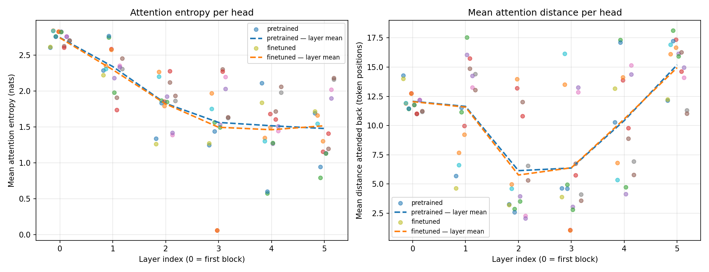

# Phase 3 — Reasoning Finetuning, Attention Analysis, and Final Report

**Model H = Hindi** (higher-resource) · **Model L = Nepali** (lower-resource)
Two fully independent monolingual decoder-only Transformers, built from
primitive PyTorch layers, pretrained separately, and finetuned separately on
synthetic comparative-reasoning data generated in each model's own language.

---

## 0. Summary of findings

Finetuning produced a large, unambiguous improvement in one thing and no
improvement at all in another, and separating the two is the main result of this
phase.

**What finetuning taught.** Answer-token cross-entropy fell from 5.2439 to
0.9408 for Model H and from 5.5367 to 1.4351 for Model L. Before finetuning,
neither model produced a bare entity name as a continuation even once in 2,000
test questions — exact match was 0.00% for both. After finetuning, Model H
answers with a correctly-formatted name 35.15% of the time and Model L 29.45%.

**What finetuning did not teach.** Neither model learned the comparison. On a
forced choice between the entities the question actually names, Model H scores
36.35% and Model L 39.30% against a chance rate of **41.67%** — both at or below
chance. Per task the agreement with chance is close to exact: Model H scores
47.40% on each of the two two-candidate families (chance 50%) and 33.40% on
three-candidate `numeric3` (chance 33.3%).

**Why the two-hop task scores below chance.** On transitive questions of the
form *"A is taller than B. B is taller than C. Who is tallest?"*, Model H
answers with the **middle entity B in 72.6% of cases and with A in 0.0%**. B is
never the correct answer. The model is selecting the name that appears twice
rather than following the chain. This is a systematic, measurable failure mode,
not noise, and it is why `transitive3` lands at 12.40% where random guessing
among three names would score 33.3%.

**Where the two resource tiers differ.** The clearest difference is not accuracy
but *grounding*: Model L answers with a name the question never mentions in
19.2–28.8% of cases, against 0.0–7.2% for Model H. The lower-resource model
falls back on memorised training names far more often. The held-out name pools
are what make this measurable.

The honest headline is that **a 25M-parameter model trained on ~500M tokens
learns the surface form of this task and not its content**, and that the
evaluation design — a forced-choice metric with a known chance rate, plus
held-out entity names — is what makes that distinguishable from success.

---

## 1. Synthetic reasoning dataset

Built programmatically so every ground-truth label is known by construction, as
the specification requires. No existing benchmark was downloaded.

Generation scripts: [`hindi/reasoning/generate.py`](../../hindi/reasoning/generate.py)
· [`nepali/reasoning/generate.py`](../../nepali/reasoning/generate.py)

### 1.1 Task families

| Family | Hops | Candidates | Example (Hindi) |
|---|---:|---:|---|
| `compare2` | 1 | 2 | विजय सोहन से धीमा है। दोनों में से तेज़ कौन है? |
| `transitive3` | 2 | 3 | मीना प्रीति से छोटी है। प्रीति सुनीता से छोटी है। सबसे बड़ी कौन है? |
| `numeric2` | 1 | 2 | संगीता की उम्र १३ साल है। रेखा की उम्र ६८ साल है। बड़ी कौन है? |
| `numeric3` | 1 | 3 | तीन लोगों में … सबसे भारी कौन है? |

Five comparable attributes — height, age, weight, speed, wealth — with the last
two available only for non-numeric comparison, since neither has a natural
numeric phrasing in either language.

Both the stated direction and the asked direction vary independently. If the
sentence says *A is taller than B* and the question asks who is **shorter**, the
answer is B. Without this the answer would simply be the first-named entity.
Measured: the answer is the first-named entity in 46% of examples.

### 1.2 Size and composition

Identical for both languages; the two corpora share no sentence, name or
template.

| Split | Examples | Templates | Entity names | Per family |
|---|---:|---:|---:|---:|
| train | 20,000 | 14 | 40 | 5,000 each |
| validation | 2,000 | 4 | 10 | 500 each |
| test | 2,000 | 4 | 10 | 500 each |

Tokenized length on the test split:

| Model | Prompt tokens (mean / max) | Answer tokens (mean / max) | Unknown-token rate |
|---|---:|---:|---:|
| H | 26.63 / 47 | 3.00 / 4 | **0.000000** |
| L | 24.80 / 39 | 2.81 / 4 | **0.000000** |

Answer token counts include the end-of-sequence token.

### 1.3 Leakage control

Both defences the specification suggests are applied **together**, and the
generator asserts the guarantee rather than assuming it:

* **Held-out entity names.** 40 / 10 / 10, disjoint across splits. A test
  question is always about people the model never saw in training.
* **Held-out templates.** 14 / 4 / 4, disjoint across splits. A test question is
  phrased in a way the model never saw either.

`generate.py` fails loudly if the name pools ever intersect. Verified
programmatically: zero overlap between any pair of splits, and zero overlap
between the Hindi and Nepali name pools and template pools.

This was not a formality. Section 4 shows both models answering test questions
with **training** names; without disjoint pools that behaviour would have been
scored as partial success.

### 1.4 Two defects found and fixed during construction

**A 45% gender-agreement leak.** Hindi comparative adjectives inflect for
gender. A question ending *"सबसे छोटी कौन है?"* asked about one woman and two
men has exactly one grammatically possible answer, so a model could score well
by matching agreement without performing any comparison. 181 of an initial 400
examples were solvable this way. Fixed by drawing every entity in an example
from a single gender, which makes the adjective carry no information about which
entity is meant. Verified: zero mixed-gender examples.

**Nepali numerals were entirely unrepresentable.** Model L's BPE vocabulary
contains **no Devanagari digit at all** — not one of ०–९ is a vocabulary piece —
and it was trained without byte fallback, so every Devanagari numeral encodes to
`<unk>`. A first draft using them ran a 4.8% unknown-token rate across the
corpus, which would have trained Model L on holes where the quantities belong.
Model H's Unigram vocabulary covers both digit systems at zero unknowns.

The Nepali generator therefore writes numerals with Arabic digits, which the
vocabulary covers completely and which modern Nepali prose overwhelmingly uses
anyway. This asymmetry between the two generators is not an inconsistency; it is
the low-resource tokenizer's coverage gap appearing in practice, and it is
reported in §7.3 rather than papered over.

### 1.5 Natural phrasing

The specification requires the target language's script *and* natural phrasing.
Nepali orthography attaches the comparative postposition and the genitive to the
preceding word — **रबिनको उचाइ**, **कल्पनाभन्दा** — and writing them detached is
the usual signature of Hindi-shaped Nepali. The templates attach them.

---

## 2. Finetuning protocol

Scripts: [`hindi/reasoning/finetune.py`](../../hindi/reasoning/finetune.py) ·
[`nepali/reasoning/finetune.py`](../../nepali/reasoning/finetune.py)
Configs: [`hindi/configs/finetune.yaml`](../../hindi/configs/finetune.yaml) ·
[`nepali/configs/finetune.yaml`](../../nepali/configs/finetune.yaml)

Every requirement of the specified protocol is met:

* each model starts from **its own** Phase 2 checkpoint — Model H from step
  14,500, Model L from step 14,000 — never from the other model and never from
  scratch;
* each keeps **its own** Phase 1 tokenizer and vocabulary, so the embedding and
  output matrices keep their pretrained rows. The finetuner asserts that the
  tokenizer's vocabulary size matches the checkpoint rather than trusting the
  config;
* checkpoints carry weights, optimizer state, scheduler state, step counter and
  the full config — the same resume-capable format as pretraining.

### 2.1 Hyperparameters

Identical for both models, so any difference in results is attributable to data
and tokenizer rather than to the recipe.

| Setting | Value | Why |
|---|---|---|
| Peak learning rate | 6e-5 | One tenth of the 6e-4 pretraining peak. The model already holds a language model worth preserving. |
| Min learning rate | 6e-6 | Cosine floor. |
| Warmup | 100 steps | See §3.3 — this interacts with the result. |
| Batch size | 32 examples | |
| Epochs | 2 (1,250 steps) | |
| Optimizer | AdamW, β=(0.9, 0.95), wd 0.1 | Decay on matrices only. |
| Gradient clip | 1.0 | |
| Precision | fp16 + GradScaler | The Kaggle T4 is sm_75 and has no bfloat16. |
| Evaluation | every 20 steps | |
| Loss | **answer tokens only** | |

Seeds differ (20260914 / 20260915) so the two runs are not correlated through
their data ordering.

### 2.2 Two design decisions worth stating

**Loss is computed on the answer only.** Prompt target positions are set to
`-1`, which the model's `cross_entropy(..., ignore_index=-1)` already skips.
Training on the prompt too would spend most of the gradient reproducing question
templates that are given for free at test time.

**Batches are bucketed by prompt length, not padded.** The models use *learned
absolute* positional embeddings, so a token's representation depends on its
index. Left-padding would move every real token to a position it never occupied
during pretraining; right-padding is fine for training but breaks generation,
which appends at the end. Grouping examples whose prompts tokenize to the same
length avoids both, with no padding in the prompt at all.

---

## 3. Results: pretrained vs. finetuned

Reports: [`hindi_reasoning_pretrained.json`](hindi_reasoning_pretrained.json) ·
[`hindi_reasoning_finetuned.json`](hindi_reasoning_finetuned.json) ·
[`nepali_reasoning_pretrained.json`](nepali_reasoning_pretrained.json) ·
[`nepali_reasoning_finetuned.json`](nepali_reasoning_finetuned.json)

### 3.1 Why two metrics

A pretrained language model has never seen this prompt format and will not
spontaneously answer with a bare name, so end-to-end exact match on it measures
"did it guess the output format" and bottoms out at zero. That makes the
pretrained column uninformative exactly where the specification asks for a
comparison. So two metrics are reported:

* **Exact match** after greedy decoding — the honest end-to-end number.
* **Forced choice** among the entities the prompt names: each candidate is
  scored by its mean log-probability per answer token and the highest wins.
  Chance is known (41.67%, computed per example from the candidate count), so
  the pretrained baseline is interpretable rather than a floor artefact.

Scores are length-normalised. Without that, short names win on total
log-probability for reasons unconnected to the question.

### 3.2 Headline table

2,000 held-out test questions per model.

| Model | Metric | Pretrained | Finetuned | Change |
|---|---|---:|---:|---:|
| **H** (Hindi) | Exact match | 0.00% | **35.15%** | +35.15 |
| | Forced choice | 39.80% | 36.35% | −3.45 |
| | Answer-token loss | 5.2439 | **0.9408** | −4.3031 |
| **L** (Nepali) | Exact match | 0.00% | **29.45%** | +29.45 |
| | Forced choice | 38.80% | 39.30% | +0.50 |
| | Answer-token loss | 5.5367 | **1.4351** | −4.1016 |
| | *forced-choice chance* | *41.67%* | *41.67%* | — |

Neither model's forced-choice score reaches chance after finetuning.

### 3.3 Per task family

Exact match, finetuned, with the chance rate for that family's candidate count:

| Model | Family | Candidates | Chance | Pretrained | Finetuned |
|---|---|---:|---:|---:|---:|
| H | `compare2` | 2 | 50.0% | 0.00% | 47.40% |
| H | `numeric2` | 2 | 50.0% | 0.00% | 47.40% |
| H | `numeric3` | 3 | 33.3% | 0.00% | 33.40% |
| H | `transitive3` | 3 | 33.3% | 0.00% | **12.40%** |
| L | `compare2` | 2 | 50.0% | 0.00% | 40.20% |
| L | `numeric2` | 2 | 50.0% | 0.00% | 38.00% |
| L | `numeric3` | 3 | 33.3% | 0.00% | 26.20% |
| L | `transitive3` | 3 | 33.3% | 0.00% | **13.40%** |

Model H's one-hop scores sit within 2.6 points of chance and its `numeric3`
score within 0.1 points. The two-hop family is the outlier, and it is *below*
chance for both models.

### 3.4 Training dynamics


Logs: [`hindi_finetune_log.jsonl`](hindi_finetune_log.jsonl) ·
[`nepali_finetune_log.jsonl`](nepali_finetune_log.jsonl)

Both models reach minimum validation loss at **step 60** — Model H at 1.4966,
Model L at 1.3427 — and rise monotonically afterwards, ending at 3.5188 and
3.5911 by step 1,250 while training loss falls to 0.44 and 0.60. That is severe
overfitting, and it is expected: with 40 training names and 14 templates, the
answer prior is memorisable long before copying from the prompt becomes
worthwhile. Saving on best validation loss meant the evaluated checkpoints were
step 60, not the badly overfit final ones.

An earlier run evaluated every 100 steps and selected its checkpoint at step 100
— which is also exactly where warmup ends and the learning rate first reaches
its peak. Re-running with a 20-step evaluation grid, changing nothing else,
moved Model L from 14.90% to 29.45% exact match and Model H from 32.70% to
35.15%. The conclusions in §0 were unchanged by this, but the numbers were, and
the coarse grid would have understated both models.

---

## 4. Error analysis

The `error_analysis` block of each report records, per task family, which prompt
position the model's answer came from, alongside where the gold answer actually
sits. Accuracy alone cannot distinguish uniform guessing from a positional habit
from a model ignoring the question entirely; this separates them.

### 4.1 The two-hop failure is systematic

`transitive3`, finetuned, distribution over answer position:

| Model | Answered A (first) | Answered B (middle) | Answered C (last) | Off-prompt |
|---|---:|---:|---:|---:|
| Gold | 47.4% | **0.0%** | 52.6% | — |
| H | **0.0%** | **72.6%** | 25.4% | 2.0% |
| L | 3.2% | 41.8% | 26.2% | 28.8% |

The middle entity is never a correct answer, because the chain is stated as
*A rel B, B rel C* and the extremes are always A and C. Model H nevertheless
selects B in 72.6% of cases and selects A in **none**. The explanation is
simple: B is the only name mentioned twice, and the model is selecting on
salience rather than following the inequality. That is precisely why the family
scores below chance — random guessing would at least hit A and C sometimes.

### 4.2 One-hop answers show a recency bias

`compare2` and `numeric2`, Model H:

| Family | Answered first-named | Answered second-named | Gold split |
|---|---:|---:|---:|
| `compare2` | 30.8% | **62.0%** | 48 / 52 |
| `numeric2` | 35.0% | **65.0%** | 50 / 50 |

Against a balanced gold distribution, Model H prefers the second-named entity
roughly two to one. The qualitative misses show it plainly — every one of these
is the model answering with the most recently mentioned name:

> ध्यान दीजिए: नवीन वरुण से अमीर है। अमीर कौन है? → **वरुण** (gold नवीन)
> ध्यान दीजिए: अरुण नवीन से बड़ा है। बड़ा कौन है? → **नवीन** (gold अरुण)

Model L is flatter — 43.8% / 37.0% on `compare2` — but only because a fifth of
its answers leave the prompt entirely.

### 4.3 Model L is much less grounded in the prompt

Rate of answering with a name the question never mentions:

| Family | Model H | Model L |
|---|---:|---:|
| `compare2` | 7.2% | **19.2%** |
| `numeric2` | 0.0% | **25.0%** |
| `numeric3` | 1.0% | **21.2%** |
| `transitive3` | 2.0% | **28.8%** |

Model L emits a memorised *training* name — repeatedly सिर्जना, निरु — instead
of one of the candidates in front of it. Both pretrained models do this 100% of
the time (99.6% for Model H on `transitive3`), so finetuning moved Model H
almost entirely onto the prompt and Model L only about three-quarters of the
way. This is the single clearest resource-tier difference in the phase.

### 4.4 Successes

Both models do get questions right, including ones requiring the direction flip:

> ध्यान दीजिए: प्रवीण वरुण से हल्का है। भारी कौन है? → **वरुण** ✓
> ध्यान दीजिए: वरुण प्रवीण से गरीब है। अमीर कौन है? → **प्रवीण** ✓
> ध्यान दिनुहोस्: निरु कल्पनाभन्दा धनी छ। धनी को हो? → **निरु** ✓

Given §4.1–4.2, these are best read as the positional habit coinciding with the
correct answer rather than as evidence of comparison.

---

## 5. Attention analysis: pretrained vs. finetuned

Module: [`hindi/reasoning/attention_compare.py`](../../hindi/reasoning/attention_compare.py)
· reports [`hindi_attention_comparison.json`](hindi_attention_comparison.json) ·
[`nepali_attention_comparison.json`](nepali_attention_comparison.json)

Both checkpoints are run on the **same** held-out comparative-reasoning prompts,
all of one token length, so neither the choice of text nor the sequence length
can masquerade as a finetuning effect. Prompts come from the reasoning test
split, so neither checkpoint has memorised them.

### 5.1 Whole-model summary

| Model | Checkpoint | Mean entropy (nats) | Mean distance (positions) | Uniform baseline |
|---|---|---:|---:|---:|
| H | pretrained | 1.9102 | 10.303 | 2.9545 (T=46) |
| H | finetuned | 1.8691 | 10.360 | |
| L | pretrained | 1.8327 | 9.415 | 2.8061 (T=39) |
| L | finetuned | 1.7833 | 10.158 | |

Both models sit about 1 nat below the uniform baseline on these prompts, so
attention is structured rather than diffuse. Finetuning **sharpened** attention
slightly in both (−0.041 and −0.049 nats) and moved it **further** along the
sequence, dramatically so for Model L: mean distance rises 0.74 positions, from
9.42 to 10.16, on a 39-token prompt.

That is the expected direction for this task — the answer is a name that appears
earlier in the prompt, so answering at all requires reaching back — and it is
consistent with §4.3, where Model L is the model that most needed to learn to
look at the prompt rather than at its own priors.

### 5.2 Per-head shifts

Layer means hide what actually happened; finetuning a small model for a narrow
task moves a few heads sharply. The largest movements:

| Model | Head | Δ entropy (nats) | Δ distance (positions) |
|---|---|---:|---:|
| H | L1H5 | −0.2734 | +1.257 |
| H | L3H1 | −0.2306 | **+2.585** |
| H | L4H3 | −0.2285 | +0.869 |
| H | L4H1 | — | −1.367 |
| L | L1H3 | −0.3336 | +1.836 |
| L | L5H5 | −0.3323 | +2.247 |
| L | L2H6 | −0.3062 | +1.412 |
| L | L3H3 | — | **+3.711** |

The pattern is consistent across both models: the heads that changed most became
**sharper and longer-range simultaneously**. Model L's L3H3 extends its reach by
3.7 positions — nearly a tenth of the whole prompt. Middle layers (1–3) dominate
the list in both models, which is where Phase 2 found the previous-token heads;
finetuning appears to have repurposed part of that machinery to look further
back for a name.

### 5.3 Heatmaps

Early layer (0) and late layer (5), four heads each, both checkpoints, both
models, with Devanagari token labels:

| | Pretrained | Finetuned |
|---|---|---|
| **H**, layer 0 | [figure](figures/hindi_pretrained_reasoning_layer0.png) | [figure](figures/hindi_finetuned_reasoning_layer0.png) |
| **H**, layer 5 | [figure](figures/hindi_pretrained_reasoning_layer5.png) | [figure](figures/hindi_finetuned_reasoning_layer5.png) |
| **L**, layer 0 | [figure](figures/nepali_pretrained_reasoning_layer0.png) | [figure](figures/nepali_finetuned_reasoning_layer0.png) |
| **L**, layer 5 | [figure](figures/nepali_pretrained_reasoning_layer5.png) | [figure](figures/nepali_finetuned_reasoning_layer5.png) |



Layer 0 is dominated by a strong attention sink at position 0 plus a tight
diagonal band — local, positional, and essentially unchanged by finetuning.
Layer 5 is visibly content-dependent, with off-diagonal stripes that align to
the repeated entity names in the question. The causal structure is exact in
every panel: the upper triangle is uniformly zero, which is the visual form of
the Phase 2 masking test.

**A caveat, stated plainly.** These shifts are real but small, and §3–4 show the
model's answers did not become more correct. The most defensible reading is that
finetuning adjusted *where* the model looks without giving it the mechanism to
use what it finds — it learned to reach back for a name, but not which name.

---

## 6. Model H vs. Model L

| Dimension | Model H (Hindi) | Model L (Nepali) | Advantage |
|---|---:|---:|---|
| Corpus tokens (train split) | 485,956,678 | 521,426,359 | L |
| Corpus bytes/token | 8.875 | 11.441 | H (finer) |
| Vocabulary | 8,000 (Unigram) | 10,000 (BPE) | — |
| Parameters | 23.3M | 24.3M | — |
| Non-embedding parameters | 18,915,328 | 18,915,328 | identical |
| Test perplexity | **27.41** | 46.68 | H |
| Test bits-per-byte | 0.5382 | **0.4846** | L |
| Reasoning exact match | **35.15%** | 29.45% | H |
| Reasoning forced choice | 36.35% | **39.30%** | L (both < chance) |
| Answer-token loss | **0.9408** | 1.4351 | H |
| Off-prompt answer rate | **0.0–7.2%** | 19.2–28.8% | H |

The two models have **identical** non-embedding parameter counts by design, so
every difference above is attributable to data and tokenizer rather than to
capacity.

The perplexity/BPB disagreement is the project's central measurement lesson and
is unchanged from Phase 2: Model L looks much worse on perplexity (46.68 vs
27.41) and slightly *better* on bits-per-byte (0.4846 vs 0.5382), because its
tokenizer packs 11.44 bytes into a token against Hindi's 8.88. Most of the
apparent gap is a tokenizer artefact, not a modelling one.

On reasoning, the two metrics also disagree — Model H wins on exact match, Model
L nominally on forced choice — but since both forced-choice figures are below
chance, that ordering carries no signal. The difference that does carry signal
is §4.3: **Model H attends to the prompt and Model L frequently does not.**

---

## 7. The four required questions

### 7.1 How did data scale and quality differ?

By raw token count the two corpora are comparable, and Nepali is nominally
larger — 521.4M vs 486.0M tokens on the train split. Scale is therefore *not*
the axis on which these models differ, which is itself the useful finding: the
project holds token budget roughly constant and varies language, tokenizer and
source quality.

Quality differs in composition. Hindi's full corpus came from 704,101 documents
with 30.66% of tokens from manual collection; Nepali's from 1,918,265 documents
at 26.41% manual — so Nepali's documents are much shorter on average and drawn
more heavily from web crawl. Nepali also
carries measurable residue from that provenance: Phase 1 reported a
`test_unk_rate` of 0.0 for Nepali but the measured value is 0.0019, because its
BPE has no byte fallback and silently drops characters it cannot represent —
Latin characters in mixed text, and, as Phase 3 discovered, **every Devanagari
digit**.

### 7.2 How do language-modeling and reasoning results compare across tiers?

They point in opposite directions, and the resolution is instructive.

On language modelling, the tiers appear far apart on perplexity (27.41 vs 46.68)
and essentially equal — slightly favouring Nepali — on bits-per-byte (0.5382 vs
0.4846). Bits-per-byte is the comparable measure across different tokenizers,
and it says the two models compress their languages about equally well.

On reasoning, both models fail the actual task equally: forced choice is at or
below chance for both. The tiers separate only on *format acquisition* — Model H
reaches 35.15% exact match and 0.9408 answer loss against Model L's 29.45% and
1.4351 — and on grounding, where Model H is three to ten times less likely to
answer off-prompt.

So: the low-resource model is not worse at modelling its language, is equally
unable to reason, and is distinctly worse at attending to the input it is given.

### 7.3 What tokenizer / corpus factors most affected the lower-resource model?

Three, in order of how much they actually cost.

1. **No byte fallback.** This is the most consequential single decision in the
   whole project. Model L's BPE cannot represent characters absent from its
   training corpus, and unrepresentable input becomes `<unk>` rather than
   degrading gracefully. Phase 3 found the sharpest case: the vocabulary
   contains **no Devanagari digit whatsoever**, so a Nepali sentence written
   with numerals ०–९ — entirely natural Nepali — tokenizes to holes. Had this
   not been caught, 4.8% of the finetuning corpus would have been `<unk>`.

2. **Coarser tokenization.** 11.44 bytes/token against Hindi's 8.88. Each token
   covers more text, so the same 512-token context holds ~31% more Nepali, but
   each prediction is correspondingly harder — which is most of the perplexity
   gap and almost none of a real quality gap.

3. **Shorter, web-heavier documents.** On the train split, Nepali packs
   521,426,359 tokens into 1,520,000 documents — **343.0 tokens per document** —
   against Hindi's 485,956,678 tokens in 675,937 documents, **718.9 per
   document**, a factor of 2.1. Less long-range structure per document is a
   plausible contributor to Model L's weaker prompt grounding in §4.3, though
   this project does not isolate it.

### 7.4 What evidence explains the observed differences?

* **Forced choice against a computed chance rate** is what shows the models did
  not learn to reason. Exact match alone would have read as +35 points of
  improvement.
* **Held-out entity names** are what show memorisation: both models answer test
  questions with training names, Model L four to ten times more often.
* **Position-level error analysis** is what shows the two-hop failure is
  systematic — 72.6% middle-entity selection against a 0.0% gold rate — rather
  than random.
* **Bits-per-byte alongside perplexity** is what shows the Model H / Model L gap
  is mostly tokenizer fertility.
* **Direct vocabulary inspection** is what shows the Devanagari-digit gap; no
  aggregate metric surfaced it.
* **Identical non-embedding parameter counts** are what license attributing any
  of this to data and tokenizer rather than to model size.

---

## 8. Deliverables

| # | Deliverable | Where |
|---|---|---|
| 1 | Reasoning data generation scripts, finetune scripts, configs | [`hindi/reasoning/`](../../hindi/reasoning/) · [`nepali/reasoning/`](../../nepali/reasoning/) · [`finetune.yaml`](../../hindi/configs/finetune.yaml) ×2 |
| 2 | Finetuned checkpoints (H and L) | Google Drive links in the [README](../../README.md) |
| 3 | Finetuning logs, metrics, qualitative examples | [`*_finetune_log.jsonl`](.) · [`*_reasoning_*.json`](.) · §3, §4 |
| 4 | Pretrain vs. finetune attention comparison | §5 · [`figures/`](figures/) · [`*_attention_comparison.json`](.) |
| 5 | Final comparison tables and error analysis | §3, §4, §6 |
| 6 | Complete final report and reproduction instructions | this document · §9 · [README](../../README.md) |

---

## 9. Reproduction

```bash
# 1. Regenerate both reasoning corpora (deterministic, seeded)
python hindi/reasoning/generate.py  --train 20000 --val 2000 --test 2000
python nepali/reasoning/generate.py --train 20000 --val 2000 --test 2000

# 2. Score the pretrained baselines FIRST - once weights are updated this
#    number cannot be recovered without retraining
python -m hindi.reasoning.evaluate_reasoning \
    --checkpoint checkpoints/hindi/ckpt_best.pt --tag pretrained
python -m nepali.reasoning.evaluate_reasoning \
    --checkpoint checkpoints/nepali/ckpt_best.pt --tag pretrained

# 3. Finetune each model on its own language only
python -m hindi.reasoning.finetune  --config hindi/configs/finetune.yaml
python -m nepali.reasoning.finetune --config nepali/configs/finetune.yaml

# 4. Score the finetuned checkpoints through the same code path
python -m hindi.reasoning.evaluate_reasoning \
    --checkpoint checkpoints/hindi_reasoning/ckpt_best.pt --tag finetuned
python -m nepali.reasoning.evaluate_reasoning \
    --checkpoint checkpoints/nepali_reasoning/ckpt_best.pt --tag finetuned

# 5. Attention comparison and all figures
python scripts/make_phase3_figures.py \
    --hindi-pretrained  checkpoints/hindi/ckpt_best.pt \
    --hindi-finetuned   checkpoints/hindi_reasoning/ckpt_best.pt \
    --nepali-pretrained checkpoints/nepali/ckpt_best.pt \
    --nepali-finetuned  checkpoints/nepali_reasoning/ckpt_best.pt
```

On Kaggle, one kernel per model runs steps 2–5 end to end:

```bash
python scripts/kaggle_push.py --what code
python scripts/kaggle_run.py --lang hindi  --mode finetune
python scripts/kaggle_run.py --lang nepali --mode finetune
python scripts/collect_phase3_results.py --lang hindi nepali --summary
```

Both model test suites pass 9/9 (`python hindi/tests/test_model.py`,
`python nepali/tests/test_model.py`), including the causal-masking check that
perturbing tokens after position *t* changes logits at positions ≤ *t* by
exactly 0.000e+00.

---

## 10. Limitations and what I would do next

Stated so the results above are not over-read.

1. **The models do not perform the task.** Forced choice is at or below chance
   for both. Everything in §5 describes a model that learned an output format.

2. **40 training entity names is too few.** It makes memorising the answer prior
   easier than learning to copy from the prompt, and both models took that path
   — validation loss turns upward by step 60. The most promising single change
   would be 200+ training names, which would make the prior much less
   rewarding. This was not run for want of time, not because it was judged
   unnecessary.

3. **The positional habits in §4.1–4.2 are diagnosed, not fixed.** Balancing
   the training distribution against answer position would test whether the
   two-hop failure is a data artefact or a capacity limit.

4. **The attention analysis is correlational.** It shows heads that moved; it
   does not establish that those heads carry the comparison. Ablating L3H1 or
   L3H3 and re-scoring would be the direct test.

5. **`transitive3` is the only multi-hop family.** Four-entity chains would show
   whether the middle-entity bias is specifically about the repeated name or
   about chain length generally.

6. **Single seed per model.** The Model H / Model L differences in §6 are not
   bracketed by run-to-run variance.
